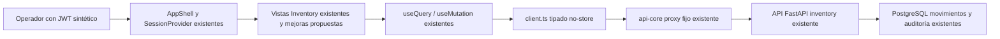

# SDD — HealthCore Inventory Manager UI · plan

## Lectura y clasificación

Fecha de discovery: 2026-11-02. Rama `feature/inventory-manager`; árbol limpio antes del trabajo. La fase inicial autorizó investigación y tres documentos. La petición posterior «ejecuta memory-bank/specs/inventory-manager-ui» autoriza la implementación frontend y pruebas del alcance sintético descrito; no autoriza contratos nuevos, SSO, cambios backend, commit, PR ni despliegue.

- **EXISTING**: comprobado en código/contrato/pruebas presentes; no equivale a pruebas ejecutadas hoy ni aprobación operativa.
- **APPROVED**: decisiones de backend D-01–D-08 y revisión ficticia `HC-INV-APPROVAL-2026-11-02` ya documentadas, limitadas al escenario sintético; no aprobación nueva de UI.
- **PROPOSED**: decisiones nuevas pendientes de revisión.
- **BACKEND GAP**: capacidad no soportada por contratos actuales.
- **BLOCKED**: ejecución que requiere autorización o contrato previo. El diseño puede estar completo con implementación bloqueada.

Fuentes: `CONTEXT.md`, `AGENTS.md`, Memory Bank obligatorio e índice/conventions, Rules 01/07/09 siempre activas y 02/05/08 consideradas por contenido; `backend/app/inventory/{router,schemas,service,policies,access_audit,retention}.py`, `backend/app/inventory/README.md`, `backend/app/auth/{dependencies,roles,router}.py`; `uis/backoffice/{README.md,package.json,next.config.ts,tsconfig.json,contracts/openapi.json}`, `src/features/inventory/`, `src/components/`, `src/styles/tokens.css`, hooks y lib API/auth; `frontend/README.md`, `frontend/app/page.module.css`; SDD previos `memory-bank/specs/inventory-manager/{spec,plan,tasks}.md` y `memory-bank/specs/migrationBackoffice/nextjs-migration/spec.md`. No se editan fuentes discrepantes ni otros documentos protegidos. El usuario ha autorizado expresamente trasladar estos tres artefactos a `memory-bank/specs/inventory-manager-ui/`.

## 1. Diagnóstico técnico

EXISTING: Next App Router en `uis/backoffice`, módulos Inventory Client, componentes comunes y proxy tipado. React19.3.1, Next16.4.3, TS5.9.3 strict, Node24 y pnpm10.18.3 ya instalados como versiones declaradas; se conservarán lockfiles. Vitest, Testing Library, Playwright y axe disponibles. No script lint configurado ni librería remota de caché instalada. Backend FastAPI central real en `backend/`; `services/central-api` no existe. No moverlo. No hay necesidad de segunda app ni reemplazo del legado.

La evidencia de tests del README es histórica; la entrega documental no ejecuta backend/Next/E2E ni acredita activación de rutas en el stack actual. Las suites disponibles se revisaron como especificación ejecutable de comportamientos; la validación posterior deberá ejecutarlas en entorno aislado.

## 2. Decisión arquitectónica propuesta

D-01 PROPOSED: alternativa A, completar módulo dentro del Next existente. C reutilización directa de componentes dentro de la misma app. B nueva app descartada como recomendación por duplicar sesión, despliegue y mantenimiento. No iframe (X-Frame-Options DENY actual), microfrontend ni nuevo design system. El mismo proxy/módulo API mantiene permisos y stock en backend.



## 3. Integración Next.js

Conservar basePath `/next`, standalone y headers existentes. Páginas Server son wrappers/layout de estructura no sensible; Client Components gestionan token en memoria, formularios y consultas. No SSR de stock con token persistido ni sesión mediante cookies. No mezclar la web pública ni importar contenido clínico. Contexto/preview como componentes feature propuestos, no librería global nueva. No instalación, build ni configuración modificados en esta fase.

## 4. Organización de rutas

| Ruta pública | Estado y propuesta |
|---|---|
| /next/connect | EXISTING conexión; conservar |
| /next/inventory/items | EXISTING catálogo y alta embebida |
| /next/inventory/items/[id] | EXISTING detalle, edición, lotes, baja, stock/historial y acciones |
| /next/inventory/stock | EXISTING stock; agrupación regional propuesta |
| /next/inventory/reorder | EXISTING alertas; configuración sigue en detalle |
| /next/inventory/audit | EXISTING eventos y denegaciones |
| /next/inventory | PROPOSED dashboard parcial opcional posterior |

D-02 PROPOSED conserva rutas actuales y añade anclas de vistas operaciones/conteo/historial; no obliga a crear rutas separadas. AppShell conserva navegación principal horizontal (no sidebar existente que reutilizar). Cambios en enlaces públicos o proxy requieren autorización específica si afectan configuración protegida; no se hacen aquí.

## 5. Directorios propuestos

Dentro de `uis/backoffice/src/features/inventory/`, conservar items/detail/stock/audit/forms/clinical-actions. Proponer context-selector.tsx, operation-preview.tsx y dashboard.tsx sólo cuando tareas los justifiquen. Páginas bajo `src/app/inventory/`; hooks comunes bajo src/hooks; comunicación en src/lib/api. Pruebas unitarias/integración en tests/ y E2E en tests/e2e/backoffice.spec.ts o fichero inventory dedicado según separación aprobada. No crear un paquete compartido duplicado ni trasladar componentes públicos. DTO wire snake_case del backend; adaptación de vista camelCase local si necesaria, sin cambiar contrato.

## 6. Look & feel y matriz de reutilización

Inspección de código y capturas históricas descrita en spec§4. Tokens EXISTING: ink#253b3a, muted#566d69, teal#42766a, dark#173f3b, line#dfe9e8, fondo#f5f9fb; panel blanco radio18px padding24px sombra0 6px24px #253b3a05. Tipografía sistema; body line-height1.65; h1 clamp28–38px, h2 19px, labels/body tabla13px, eyebrow11px. Contenedor1160px/padding24px, separación panel24px, grid18px. Botones min-height42px/radio9px, foco3px dark offset4px; estados error#b42318/success#067647 con texto. Marca SVG local cruz; sin dependencia iconográfica. Breakpoints900/760/560; tabla min-width640 y scroll local. Footer institucional y aviso sintético existentes. Mantener reduced-motion.

| Requerido | Equivalente y ruta existente | Reutilización / componente nuevo | Justificación |
|---|---|---|---|
| Header, marca y navegación | src/components/app-shell.tsx | Directa; adaptar enlaces | Mismo rol/sesión; no sidebar nuevo |
| Footer y aviso sintético | app-shell.tsx; tokens.css | Directa | No presentar producción |
| Títulos y layout | PageHeader en components/ui.tsx; .page-shell/.panel | Directa | Jerarquía y ancho existentes |
| Botones | Button ui.tsx y .button tokens.css | Directa | Estados y foco ya disponibles |
| Campos y selectores | Input/Select/Textarea/FieldErrors ui.tsx | Adaptar | Validación y errores asociados |
| Selector clínica/lote | Input UUID actual detail.tsx/stock.tsx; Select ui.tsx | Nuevo feature context-selector si aprobado | Clínicas nominales bloqueadas GAP-01; lotes por código de LotRead accesible |
| Tarjetas KPI | .metrics-grid/.metric-card; features/incidents/summary.tsx | Adaptar sólo presentación | Fórmulas Inventory nuevas, no métricas incidencias |
| Tablas | DataTable/Pagination ui.tsx | Directa con mejoras verificadas de caption/scroll | Arrays paginados sin total |
| Hechos/saldos | .facts; detail.tsx/stock.tsx | Adaptar | Última recepción local y saldo orientativo |
| Alertas/estados | Alert/ErrorState/LoadingState/MutationState ui.tsx | Directa y adaptar mensaje | Error distinto de cero y de incierto |
| Diálogos | OperationForm forms.tsx, dialog nativo | Adaptar contexto/preview | Actual confirmación genérica no basta |
| Conversión/conteo previo | ClinicalActions actual sin preview dinámico | Nuevo operation-preview feature | Necesario REQ020/023; no reimplementar transacción |
| Historial/corrección | detail.tsx tabla y clinical-actions.tsx UUID libre | Adaptar selección desde fila | Contexto original conocido, compensación enlazada |
| UTC/local | audit.tsx UTC texto actual | Adaptar con Intl.DateTimeFormat/time | No nueva librería de fechas |
| Reorden agrupado | InventoryStock stock.tsx | Adaptar grupos locales | No altera contrato, página parcial |
| Identidad pública | frontend/app/page.module.css y marca SVG page.js | Referencia visual; no importar página/hero | Separación pública/interna; tokens ya reproducidos |
| Legado nativo | operational-incidents/styles.css; management/styles.css | Referencia; no sustituir | Next ya adapta marca y patrones |

## 7. Componentes compartidos

Mantener ui.tsx para primitivas; conocimiento de stock, presentación, clínica y lotes vive en feature. No mover hooks sólo por esta tarea. Todo cambio común requiere prueba de regresión de incidentes/Management. Preferir preview puro y selección del original cargado. La tabla de auditoría sólo representa DTO redactado; no componente que consulte datos ocultos.

## 8. Capa API

EXISTING generated.ts deriva de contracts/openapi.json; types.ts alias Item/Stock/Schema; client.ts usa fetch same-origin /next/api-core, timeout15s, no-store y ApiError. forward.ts allowlist por OpenAPI, BACKEND_URL server-only, body acotado y development/test. Reutilizar sin ampliar seguridad en esta fase. Inventario exacto spec§10 API01–16. Revisar drift runtime/snapshot antes de regenerar; no nueva dependencia ni API.

PROPOSED: pequeños wrappers tipados para vistas si reducen duplicación; validar respuesta mínima que acredita éxito (id/accepted/contexto) sin convertir cast TS en validación runtime. Si se detecta DTO inesperado tras escritura, clasificar incierto, no repetir. Errores de negocio409 no tienen código discriminado estable: mensaje seguro por operación, y ampliación GAP-02 si se requiere precisión automática.

## 9. Autenticación y permisos

EXISTING JWT manual sintético, sólo memoria SessionProvider, limpieza401/desconectar/recarga. Roles y scopes spec§11; no generalizar capability Management a Inventory. PROPOSED continuar sesión existente dentro de la app; cruzar frontend/legado implica reconexión actual, no transmitir JWT por URL/storage. SSO/cookie compartida/refresh es alternativa futura BLOCKED a aprobación de seguridad/Tecnología. Un selector de clínica limita presentación, nunca autoriza.

## 10. Gestión de estados

EXISTING useQuery por path+session con cancelación; no caché compartida ni QueryClient. useMutation bloqueo síncrono y error uncertain/ack. PROPOSED estado remoto por contexto y hora de recepción local; registrar intención incierta mínima en memoria de sesión para no perder aviso navegando dentro del módulo, sujeto a D-09. Sin persistencia ni promesa entre pestañas/recarga. Desechar payload de confirmación al cambiar clínica/lote/artículo/sesión.

## 11. Formularios y validación

Reutilizar OperationForm/FieldErrors. Validadores cliente sólo para formato: trim, patrones, longitudes, entero estricto y rango; no truncar decimales ni aceptar string vacía como0. Presentación una sola; código/unidad/lotes inmutables en edición. Conteo base no negativo y motivo; lote existente del artículo; salida saldo mostrado orientativo. Confirmación rica con tipo/clínica/lote/cantidad base; conteo previo/diferencia; corrección original. API valida concurrencia, referencia, saldo total/baja y compensación.

## 12. Política de actualización

Consulta al entrar/cambiar contexto; botón Actualizar; invalidación tras confirmación; hora local de recepción no timestamp servidor. Sin polling/WebSockets/SSE ni nuevo cache. Dependencias: alta/edición/baja→item/catálogo/stock/reorden de contexto; lote→lista de lotes; configuration→stock/reorden; movimiento/conteo/corrección→stock/historial/reorden/auditoría si autorizada. No consultar auditoría con manager. Actualizar todas las vistas abiertas relevantes al volver a entrar, sin precargar clínicas ilimitadas.

## 13. Errores y concurrencia

State machine spec§9/12. Escrituras confirmadas sólo con respuesta fiable; 5xx/red/timeout/parse se tratan inciertas. No optimistic stock/retry escritura. Dos operadores pueden ver mismo saldo; lock estable backend bajo READ COMMITTED decide saldo real y serializa por item aun entre clínicas. Cliente no replica lock ni reserva. Regional no snapshot global; offsets con inserciones pueden repetir/omitir filas: mostrar página parcial, no afirmar completa.

Resultado incierto: bloquear formulario, mantener intención segura en memoria, ofrecer GET stock/historial y reconocimiento explícito. UUID server MovementRead llega sólo si hubo respuesta; no clave cliente ni deduplicación entre pestañas. Revisión manual no acredita exactamente ausencia de registro; conciliación fuerte GAP-03 bloquea habilitación real. Cancelación después de envío no acredita rollback.

## 14. Seguridad

Conservar no-PHI, redacciones y política de24 meses APPROVED backend; ninguna eliminación. No log de JWT/body/motivo, ninguna public env secreta. El diseño de nuevas representaciones de auditoría y posible memoria de intención requiere D-09 y revisión Claire antes de implementación, sin inventar nueva firma/revisión. No cambio de storage/auth/audit/proxy/infra sin autorización expresa. Desarrollo y validación con datos sintéticos aislados.

## 15. Estrategia de pruebas

| Área | Pruebas EXISTING revisadas | Pruebas futuras y evidencia |
|---|---|---|
| DTO y errores | tests/client.test.ts; forward.test.ts; backend/test_inventory.py | mocks200/201/401/403/404/409/422/503/timeout/JSON inválido, no retry |
| RBAC/scopes | test_scopes_are_signed_and_role_specific; test_existing_roles_get_no_inventory_permissions; E2E Inventory | cinco roles + roles previos, US/UK fuera scope, scope vacío |
| Catálogo/presentación/lote | test_inventory_http_lifecycle_lots_history_and_reorder; E2E catálogo | campos inmutables, pack3×10, baja cero/no cero, lote ausente/ajeno |
| Stock/operaciones | lifecycle; test_postgresql_concurrent_exits_and_immutable_history | stock0, insuficiente, lote saldo y umbral total, conteo0, respuesta distinta preview |
| Correcciones | lifecycle y E2E conteo/corrección | seleccionar original, correction_of, previa, negativo, compensación no compensable |
| Auditoría | test_inventory_audit_policy.py; E2E auditor | redacción, null país, país histórico cambiado, denied durable y503 |
| Incertidumbre | client/hook tests y E2E respuesta perdida | doble clic/Enter, timeout postcommit, no reenvío/éxito ficticio, navegar/reconectar |
| Calidad/responsive | Vitest, axe/Playwright existentes | TS estricto, regresión legado/Next,320/393/768/1350, teclado/lector/zoom manual |

Sólo usar harness sintético descrito en README; nunca bases compartidas. Pruebas backend de integración exigen nombre inventory_validation; telemetría tiene aislamiento específico. No se ejecutarán sólo para una modificación documental; no prometer recuentos históricos como validación actual.

## 16. Fases y orden

Fase0 auditoría/caracterización y aprobación de decisiones. Fase1 reutilizar base Next, sesión y layout sin reinstalar. Fase2 contexto/previews/fechas/estados. Fase3 consultas detalle y stock, catálogo; Fase4 entradas/salidas y conteo/corrección; Fase5 reorden/auditoría y agrupación/dashboard; Fase6 calidad y cierre. Tasks define unidades pequeñas y dependencias reales. No ejecutar tareas en esta fase.

## 17. Riesgos y mitigaciones

| Riesgo | Mitigación y estado |
|---|---|
| Documentación histórica contradice código | Registrar discrepancia; no cambiar fuente protegida |
| Error selección clínica | Contexto visible, selector de IDs scope y API; selector nominal GAP-01 BLOCKED |
| Repetición tras timeout | Bloqueo/ack; GAP-03 exacto pendiente; no habilitar uso real |
| Datos regionales parciales/concurrentes | Etiquetas página/hora, actualización explícita, no total ni suma heterogénea |
| Claims manipulados | Presentación exclusivamente; API verifica firma/permiso |
| Reutilización rompe otros módulos | Pruebas unitarias/E2E regresión antes de entrega |
| Motivos o tokens en evidencia | Synthetic fixtures, traces/screenshots de credenciales desactivados |
| Retención interpretada como borrar | Sólo retention_until, fuera disposición ejecutable |

## 18. Dependencias externas

Ninguna librería o servicio nuevo recomendado. Intl.DateTimeFormat y primitivas HTML/React bastan. Lint futuro sólo si se aprueba introducir/configurar herramienta; actualmente no script. SSO y backend gaps requieren decisiones separadas, no dependencia implícita del diseño documental.

## 19. Registro de decisiones PROPOSED

Cada decisión tiene recomendación, alternativa, ventajas, inconvenientes, impacto y estado. D aquí son decisiones UI, no D backend aprobadas.

| ID | Recomendación | Alternativas | Ventajas | Inconvenientes | Impacto / aprobación |
|---|---|---|---|---|---|
| D-01 Ubicación/Next | uis/backoffice/src/features/inventory y app/inventory existentes | B nueva app; C paquete compartido entre apps | Reutiliza runtime/API/auth; menor mantenimiento | Cambios comunes necesitan regresión | PROPOSED completar A; estructura ya EXISTING; ejecución BLOCKED a autorización |
| D-02 Navegación | Conservar /next y vistas embebidas; dashboard adicional posterior | Diez rutas independientes, sidebar | Menos ruptura, contexto del artículo | Detalle largo requiere anclas | PROPOSED; sin despliegue/proxy nuevo |
| D-03 UX | Contexto visible y resumen confirmación/conversión/conteo/original | Confirmación genérica actual | Menor error operativo | Más paso en operaciones | PROPOSED; cambios sólo Inventory salvo aprobación común |
| D-04 Clínicas | MVP IDs scope para operador/manager; lotes desde catálogo, regional desde filas/UUID | Lookup backend autorizado | Viable contratos actuales | Sin nombres ni selector completo | PROPOSED MVP; lookup/histórico BACKEND GAP-01 y BLOCKED a contrato |
| D-05 Idioma/dispositivos | Español inicial, escritorio, tablet; móvil adaptable; Intl locale/zona explícitos | Inglés; mobile primero; UTC sólo | Alinea interfaz actual; formatos claros | Red US/UK puede necesitar inglés | PROPOSED; no idioma aprobado de organización |
| D-06 Dashboard | Página con posiciones/alertas recibidas y hora; admin catálogo | KPI global vía API futura; sólo enlaces | Sin sumar unidades distintas ni inventar totales | Resumen parcial | PROPOSED P1; total BACKEND GAP-04 |
| D-07 Búsqueda/exportar | Filtros/orden local etiquetados por página; exportación e impresión fuera MVP | Búsqueda servidor/exportación completa | Cero nuevos contratos | Menor alcance de búsqueda | PROPOSED; servidor/exportación requiere aprobación; prioridad por déficit por fila |
| D-08 Actualización/caché/librerías | useQuery/useMutation existentes, no-store, refresh/invalidate, sin nuevas libs | TanStack Query; polling; SSE | Menos dependencias, sin datos entre sesiones | Invalidación manual; no snapshot | PROPOSED; caché/dep nuevas requieren aprobación |
| D-09 Auth/auditoría/incierto | Memoria sesión actual, reconexión entre apps; representar sólo DTO redactado y aviso incierto | SSO/cookie compartida; idempotencia con operation_id | Mínimo alcance actual | JWT dev y resultado incierto limitados | PROPOSED; tratamiento nuevo/identidad/contrato BLOCKED a Tecnología/Claire; aprobación ficticia previa no se amplía |
| D-10 MVP/roadmap | Consultas, catálogo/stock y movimientos principales, conteo/corrección/reorden y auditoría existentes endurecidos | Sólo consulta; alcance global en un lote | Reutiliza implementación, tareas acotadas | Aprobaciones UI pendientes | PROPOSED; P1 dashboard/agrupación/filtros/localización avanzada posteriores |

MVP sintético tras autorización: rutas actuales, todas las operaciones backend actuales, preview/contexto/errores/fechas y regresión. Consulta puede entregarse antes de escritura; no considerar consultas solas cierre de alcance. Roadmap posterior: dashboard y agrupación, filtros locales; luego lookup/errores estructurados/idempotencia sólo con contrato autorizado; exportación/impresión y SSO en proyectos separados. No pedidos/traslados/caducidad por inferencia.

## 20. Validación y entrega

Actual diseño: revisar documentos completos, enlaces relativos y cobertura de diez pantallas/54 EARS/16 endpoints/tareas/dependencias; comprobar git status/diff con sólo tres archivos nuevos, sin secretos/PHI ni fuentes protegidas. Aplicar validate-delivery read-only. No comandos de migración, tests de datos ni builds por esta fase documental.

Tras implementación autorizada: `pnpm types:check`, `pnpm typecheck`, `pnpm test`, `pnpm build` desde uis/backoffice en entorno sintético aprobado. No `pnpm lint` inexistente; resolver D-lint si se exige. E2E `HC_SYNTHETIC_TESTS=1 BACKOFFICE_TEST_URL=http://127.0.0.1:3100 BACKOFFICE_TEST_API=http://127.0.0.1:18190 pnpm test:e2e` sólo con fixture API aislada y Next verificados. Harness puede instalar tooling sólo con autorización de dependencia. Backend regresión sólo base desechable confirmada; no tocar .env ni datos operativos. Revisión manual visual actual desktop/tablet/mobile y WCAG obligatoria; resultados por criterio, no screenshots con credenciales. Cierre PASS sólo con criterios aplicables verificados, permisos expresos y sin bloqueos de implementación. Commit/PR/despliegue siempre autorizaciones separadas.

## 21. Ejecución y evidencia — 2026-11-02

La petición posterior de ejecutar este SDD autoriza completar las vistas frontend y pruebas con fixtures sintéticos. Se conservan versiones, lockfiles, roles/scopes, proxy, backend, infraestructura y retención; no se extiende la aprobación simulada de Claire ni se implementan brechas de contrato. Memoria de resultado incierto sólo contiene título/contexto sin texto del motivo y se limpia con la sesión existente.

Cambios: dashboard y navegación; selectores de scope/lotes; validación de enteros/presentación; confirmaciones con clínica/cantidad/conversión/diferencia; selección del original desde historial; respuesta validada; saldos confirmados; fechas local/UTC y recepción; búsqueda/estado/grupos/prioridad de página; gate compartido en memoria incluso ante pérdida de respuesta después de desmontar el formulario. Se preservan componentes/tokens; README bilingües actualizados.

### Comandos ejecutados y entorno

Desde la raíz, donde se indica /work se monta únicamente el backoffice existente. Tooling Node24 ya disponible; no dependencias de aplicación nuevas. Los binarios opcionales actuales son Linux: Vitest nativo macOS falla por binding rolldown ausente; se valida en su contenedor compatible sin reinstalar ni cambiar lockfiles. El harness pgserver necesitó permiso de sandbox para su lockfile; Chrome también requiere ejecución fuera de sandbox.

```sh
# Contrato de tipos, desde uis/backoffice; PASS, exit0
/private/tmp/healthcore-backoffice-toolchain/node_modules/node/bin/node scripts/check-contracts.mjs
# TS estricto, desde raíz; PASS, exit0; también ejecutado dentro del build
/private/tmp/healthcore-backoffice-toolchain/node_modules/node/bin/node uis/backoffice/node_modules/typescript/bin/tsc --noEmit -p uis/backoffice/tsconfig.json
# Unitarias/integración simulada; PASS, exit0:57 pruebas,6 ficheros
podman run --rm -v /Users/arkaitz.bregel/personales/4geeks/4geeks-aiengineering/uis/backoffice:/work -w /work node:24-alpine node node_modules/vitest/vitest.mjs run
# Build; PASS, exit0; compilación, tipos y rutas existentes + /inventory
podman run --rm -v /Users/arkaitz.bregel/personales/4geeks/4geeks-aiengineering/uis/backoffice:/work -w /work -e NEXT_TELEMETRY_DISABLED=1 -e APP_ENVIRONMENT=test -e BACKEND_URL=http://127.0.0.1:18190 node:24-alpine node node_modules/next/dist/bin/next build
# Harness API aislado, desde raíz; no lee .env, DB temporal nueva, seeds/demo sintéticos
/private/tmp/healthcore-inventory-py312/bin/python uis/backoffice/scripts/validation-api.py
# Runtime QA, desde uis/backoffice; aplicación compilada en13101 contra API temporal18190
APP_ENVIRONMENT=test BACKEND_URL=http://127.0.0.1:18190 HOSTNAME=127.0.0.1 PORT=13101 /private/tmp/healthcore-backoffice-toolchain/node_modules/node/bin/node scripts/start.mjs
# E2E final, desde uis/backoffice; PASS, exit0:18 pruebas en17.4s
HC_SYNTHETIC_TESTS=1 BACKOFFICE_TEST_URL=http://127.0.0.1:13101 BACKOFFICE_TEST_API=http://127.0.0.1:18190 /private/tmp/healthcore-backoffice-toolchain/node_modules/node/bin/node node_modules/@playwright/test/cli.js test
# Diff y alcance, desde raíz
git diff --check
git status --short
```

Los fallos iniciales de pruebas simuladas provenían de mock de sesión inestable y selección deshabilitada; fueron corregidos. Chrome detectó el selector de compensación bloqueado y se corrigió separando disponibilidad de campos y permiso de envío. Las pasadas de regresión posteriores verifican el arreglo. No se eliminó ningún control para hacer pasar tests.

Pruebas existentes de incidencias/Management, Inventory HTTP y auditoría pasan en la suite E2E; la suite completa backend no se repite porque no se cambia backend. Lint NOT RUN: no hay script/tooling configurado; no se introduce una dependencia por inferencia. Validación visual actual: capturas temporales de dashboard desktop/mobile y catálogo, sólo identidad sintética conectada con input JWT limpio. Token nunca se registra ni se guarda en capturas/traces.

### Límites y validación pendiente

Axe y reflow por viewport comprueban320/393/768/1350 en dashboard, catálogo, detalle clínico, stock y auditoría; teclado/validación/Escape/retorno de foco ejercitados. No equivalen a certificación WCAG2.2AA. Quedan lector de pantalla, zoom200%/reflow400% y revisión manual integral de foco/contraste de todos los estados. INV-UI-TASK-018 PARTIAL y019 BLOCKED para cierre integral. La revisión final no puede declarar PASS completo sin esa evidencia. Sin nuevas aprobaciones de Cumplimiento, sin commit/PR/despliegue.

Resultado final automatizado: **57 pruebas unitarias/integración simulada y18 E2E superadas**, sin skips. Build y revisión de tipos PASS. Los servidores QA se detienen tras validar; no hay despliegue ni sustitución del stack operativo.

### Continuación de accesibilidad

Revisión adicional del catálogo conectado con datos sintéticos: estructura accesible (encabezados y etiquetas), ausencia de scroll de página a640/320px, ampliación CSS200% sin overflow y foco de teclado3px sólido. Capturas temporales inspeccionadas visualmente. CSS zoom y viewport equivalente no sustituyen zoom real del navegador ni lector de pantalla.

Se detectó contraste1,64:1 en los bordes existentes #bdcec9 sobre blanco; corregido sólo dentro de Inventory mediante token muted#566d69 (5,55:1 sobre blanco). Botones secundarios incluidos; componentes de otras áreas conservan su estilo. El texto teal/blanco5,21:1, aviso muted sobre conexión4,88:1 y error/blanco6,57:1 superan4,5:1. No se declara revisión integral de todos los estados. 018 permanece PARTIAL y019 BLOCKED por lector de pantalla y revisión manual integral pendientes.

Comando de caracterización temporal: `/private/tmp/healthcore-backoffice-toolchain/node_modules/node/bin/node /private/tmp/inventory-accessibility-review.mjs`, exit0. Sólo pruebas sintéticas en API desechable; sin escrituras de catálogo durante esta comprobación.

Validación posterior a la corrección: build y TypeScript strict con los comandos de §21 PASS, exit0; `git diff --check` PASS, exit0. Desde uis/backoffice: `HC_SYNTHETIC_TESTS=1 BACKOFFICE_TEST_URL=http://127.0.0.1:13101 BACKOFFICE_TEST_API=http://127.0.0.1:18190 /private/tmp/healthcore-backoffice-toolchain/node_modules/node/bin/node node_modules/@playwright/test/cli.js test tests/e2e/inventory-ui.spec.ts`: PASS, exit0,3 casos en7,2s. Incluye aserción del borde corregido y ampliación CSS200%, axe a cuatro anchos, flujos clínicos y resultado incierto. No se vuelve a afirmar ejecución de las57 unitarias/18 E2E completas para esta continuación (son evidencia de la ejecución previa).

Checklist manual ejecutable: [accessibility-review.md](./accessibility-review.md). Casos M01–M08 NOT RUN; acceso nativo a Chrome no permitió completar revisión sin interferir con llamada activa. No se declara nueva evidencia de zoom/VoiceOver.
