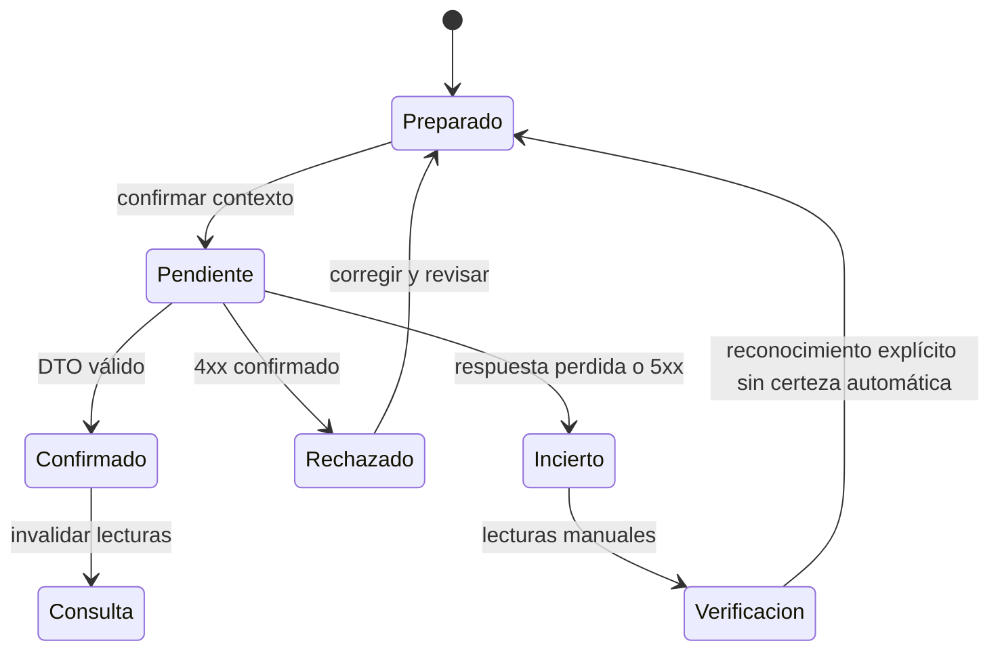

# SDD — HealthCore Inventory Manager UI · spec

## Lectura y clasificación

Fecha de discovery: 2026-11-02. Rama `feature/inventory-manager`; árbol limpio antes del trabajo. La fase inicial autorizó investigación y tres documentos. La petición posterior «ejecuta memory-bank/specs/inventory-manager-ui» autoriza la implementación frontend y pruebas del alcance sintético descrito; no autoriza contratos nuevos, SSO, cambios backend, commit, PR ni despliegue.

- **EXISTING**: comprobado en código/contrato/pruebas presentes; no equivale a pruebas ejecutadas hoy ni aprobación operativa.
- **APPROVED**: decisiones de backend D-01–D-08 y revisión ficticia `HC-INV-APPROVAL-2026-11-02` ya documentadas, limitadas al escenario sintético; no aprobación nueva de UI.
- **PROPOSED**: decisiones nuevas pendientes de revisión.
- **BACKEND GAP**: capacidad no soportada por contratos actuales.
- **BLOCKED**: ejecución que requiere autorización o contrato previo. El diseño puede estar completo con implementación bloqueada.

Fuentes: `CONTEXT.md`, `AGENTS.md`, Memory Bank obligatorio e índice/conventions, Rules 01/07/09 siempre activas y 02/05/08 consideradas por contenido; `backend/app/inventory/{router,schemas,service,policies,access_audit,retention}.py`, `backend/app/inventory/README.md`, `backend/app/auth/{dependencies,roles,router}.py`; `uis/backoffice/{README.md,package.json,next.config.ts,tsconfig.json,contracts/openapi.json}`, `src/features/inventory/`, `src/components/`, `src/styles/tokens.css`, hooks y lib API/auth; `frontend/README.md`, `frontend/app/page.module.css`; SDD previos `memory-bank/specs/inventory-manager/{spec,plan,tasks}.md` y `memory-bank/specs/migrationBackoffice/nextjs-migration/spec.md`. No se editan fuentes discrepantes ni otros documentos protegidos. El usuario ha autorizado expresamente trasladar estos tres artefactos a `memory-bank/specs/inventory-manager-ui/`.

## 1. Resumen ejecutivo

Completar y ordenar una UI interna ya parcialmente implementada dentro de `uis/backoffice`, sin duplicar aplicación. Consultas y operaciones esenciales disponen de backend. Faltan UX de confirmación, preview, contexto, dashboard y agrupación regional. La fase inicial produjo el diseño; la ejecución frontend posterior se registra en §19.

## 2. Contexto y objetivos

HealthCore opera 12 clínicas (9 US y 3 UK). El módulo sirve a operaciones de inventario y auditoría, sin datos de pacientes ni integración EHR. Región significa país; no significa una zona horaria ni habilita transferencias internacionales. Objetivos: lectura autorizada, operaciones confirmadas, corrección inmutable y necesidades de reposición.

## 3. Alcance y exclusiones

Incluye las diez vistas de §8, con rutas y secciones reutilizadas. Excluye compras, pedidos, traslados, caducidades, stock editable, múltiples presentaciones, reactivación, exportación/impresión, APIs/migraciones nuevas, cambios de identidad y despliegue. El MVP no elimina las tareas necesarias para el alcance completo.

## 4. Hallazgos y discrepancias

| Estado | Evidencia y conclusión |
|---|---|
| EXISTING | Next16.4.3/React19.3.1/TS5.9.3 strict, Node24, pnpm10.18.3 y App Router ya en backoffice; no migración nueva del legado necesaria. |
| EXISTING | Catálogo, alta/edición, lotes, baja, stock/historial, movimientos, conteos, correcciones, reorden y auditoría tienen componentes; se requiere caracterizarlos, no rehacerlos. |
| EXISTING | Proxy `/next/api-core` derivado de snapshot OpenAPI, Bearer en memoria y no-store; allowlist inventory ya presente. |
| EXISTING | Backend real en `backend/`; no existen `services/central-api/`, `backoffice/`, `specs/` raíz ni `/uis/website`. No trasladar API ni frontend. |
| EXISTING | Memory Bank tecnológico/README plantilla y párrafos históricos indican ausencia de UI/API; código y README backoffice contradicen esa foto. El SDD previo de migración incluye secciones de discovery anteriores y ampliación de autorización; no reutilizar sus pendientes como estado actual. |
| APPROVED | Tres artefactos en `memory-bank/specs/inventory-manager-ui/`, siguiendo la organización SDD de Memory Bank. El usuario ha autorizado expresamente este traslado; los demás archivos de Memory Bank permanecen fuera de alcance. |

Inspección visual: imágenes existentes `audit/after/website-desktop-1.page.png` y `backoffice-desktop-1.page.png` muestran marca, verde, header blanco, tarjetas redondeadas y fondo pálido. Son evidencia visual histórica con contenido recortado; no constituyen verificación visual actual de Inventory/Next. Código tokens/componentes actuales confirma continuidad. La revisión live completa y mobile está planificada, sin afirmar WCAG ni validación visual integral ejecutada.

## 5. Roles y autorización

Matriz EXISTING de `inventory/policies.py`; los roles anteriores no heredan estos permisos, aunque nombres de capabilities coincidan en otros dominios. Actor tiene un rol, clinic_ids y jurisdiction_ids firmados; no composición de roles ni editor de permisos UI. Claims decodificados sólo controlan presentación. Backend firma/verifica y autoriza cada operación.

## 6. Requisitos funcionales EARS

Todos los requisitos de esta especificación son comportamiento objetivo **PROPOSED** de UI, salvo evidencia de implementación indicada en fuente; aprobación backend no aprueba interfaz. P0 bloquea MVP aplicable; P1 alcance posterior. Cada criterio se verifica con escenarios sintéticos; estados/errores generales se aplican a cada pantalla. Fuente `Prompt` significa el adjunto de esta petición, sin nuevas aprobaciones.

| ID | Pantalla | Prioridad | Fuente | Requisito EARS | Criterio de aceptación |
|---|---|---|---|---|---|
| REQ-INV-UI-001 | Todas | P0 | policies.py; presentation.ts | WHEN un usuario conecta al módulo, THE system SHALL mostrar navegación y acciones según su rol Inventory legible y mantener la autorización final en la API. | Los cinco roles muestran sólo acciones de la matriz; admin y direction no obtienen Inventory. |
| REQ-INV-UI-002 | 04–08 | P0 | Prompt §§6–14; contratos inventory | WHILE exista una operación clínica preparada, THE system SHALL mostrar clínica e identificador activos y bloquear el envío sin contexto válido. | Sin clínica no se envía; cambiar clínica elimina stock previo y cualquier confirmación pendiente. |
| REQ-INV-UI-003 | 04–10 | P0 | use-query.ts; session.tsx | WHEN cambie el ámbito o la sesión, THE system SHALL cancelar lecturas previas y descartar sus respuestas y estados. | Una respuesta retrasada US no aparece después de seleccionar UK o desconectar. |
| REQ-INV-UI-004 | 04–09 | P0 | policies.py; GAP-01 | WHERE se disponga de clínicas autorizadas verificadas, THE system SHALL limitar el selector de stock actual al ámbito efectivo. | Operador/manager sólo clínicas asignadas; regional/auditor sólo país vigente; sin lookup no se inventan nombres. |
| REQ-INV-UI-005 | 01 | P1 | Prompt §§6–14; contratos inventory | WHEN se consulte el dashboard, THE system SHALL presentar conteos de posiciones y alertas de la página consultada con clínica, hora y etiqueta de cobertura parcial. | No muestra suma de unidades heterogéneas ni total global; admin sólo resumen del catálogo. |
| REQ-INV-UI-006 | 01 | P1 | Prompt §§6–14; contratos inventory | IF una consulta del dashboard falla, THEN THE system SHALL marcar esa tarjeta como no disponible sin sustituirla por cero. | Stock correcto y reorden fallido se muestran separados. |
| REQ-INV-UI-007 | 02 | P0 | Prompt §§6–14; contratos inventory | WHEN se consulte catálogo, THE system SHALL mostrar código, título, unidad, presentación, lotes y activo de los artículos recibidos. | Incluye activos e inactivos devueltos; enlace a detalle; vacío diferente de error. |
| REQ-INV-UI-008 | 02,04,07–10 | P0 | router.py | WHEN se avance de página, THE system SHALL enviar offset y limit reales sin inferir total ni fin definitivo de reorden a partir de una página corta. | limit 50, anterior hasta cero, siguiente manual; texto parcial y orden fijo del servidor. |
| REQ-INV-UI-009 | 02,09 | P1 | Prompt §§6–14; contratos inventory | WHERE se habilite búsqueda local, THE system SHALL etiquetarla como filtro de la página recibida y no enviar parámetros de búsqueda no soportados. | Texto/estado sólo filtran colección cargada; reset al cambiar contexto. |
| REQ-INV-UI-010 | 03 | P0 | schemas.py | WHEN se prepare un alta, THE system SHALL validar título 1–200, código 1–100 con patrón permitido y unidad 1–80 después de trim. | Vacíos, espacios y código inválido bloquean envío; no existe campo stock. |
| REQ-INV-UI-011 | 03 | P0 | schemas.py | WHEN se edite un artículo, THE system SHALL enviar sólo title, pack_label y pack_size editables y mostrar código, unidad y uses_lots como inmutables. | Payload PATCH sin extras; al menos un atributo; título/pack_size no null. |
| REQ-INV-UI-012 | 03 | P0 | schemas.py; service.py | WHEN se configure una presentación, THE system SHALL validar pack_size entero entre 1 y 1000000000 y pack_label de 1–80 caracteres si existe. | Sin etiqueta sólo pack_size=1; una presentación por artículo; null elimina etiqueta con equivalencia válida. |
| REQ-INV-UI-013 | 03,04 | P0 | Prompt §§6–14; contratos inventory | IF el servidor rechaza código duplicado o presentación incoherente, THEN THE system SHALL conservar el formulario seguro e informar del rechazo sin anunciar éxito. | 409 duplicado; 422 validación; saldo sin cambio. |
| REQ-INV-UI-014 | 04 | P0 | service.py | WHEN se solicite baja lógica, THE system SHALL pedir motivo 1–500 y confirmación y delegar la condición de saldo total cero en la API. | Admin sin permiso stock puede solicitar; 409 informa rechazo; 200 marca inactivo; no reactivación. |
| REQ-INV-UI-015 | 04 | P0 | router.py; schemas.py | WHERE el artículo use lotes, THE system SHALL listar sus lotes y permitir al admin crear un código válido sin edición, caducidad ni eliminación. | POST code patrón 1–100; sin lots se oculta alta; duplicado/referencia inexistente no es éxito. |
| REQ-INV-UI-016 | 04 | P0 | service.py: stock | WHEN se consulte stock, THE system SHALL mostrar quantity y unidad base, equivalencias recibidas y alcance artículo/clínica/lote. | Sin lote saldo total; lote seleccionado saldo del lote; bandera reorden sigue siendo del total clínico. |
| REQ-INV-UI-017 | 04,08 | P0 | service.py; GAP-02 | IF stock responde 409 por configuración ausente, THEN THE system SHALL mostrar configuración requerida y no saldo cero. | Cero sólo con 200 quantity=0; otros 409 quedan como conflicto no identificado si no hay detalle fiable. |
| REQ-INV-UI-018 | 04–09 | P0 | Prompt §§6–14; contratos inventory | WHEN se complete una lectura, THE system SHALL mostrar hora de recepción local, zona y acción Actualizar sin presentarla como timestamp del servidor. | StockRead no contiene fecha; refresh obtiene nueva respuesta y marca carga. |
| REQ-INV-UI-019 | 05 | P0 | schemas.py; service.py | WHEN se prepare entrada o salida, THE system SHALL validar quantity entero 1–1000000000, clínica, artículo activo y lote obligatorio del mismo artículo cuando aplique. | 0, negativos, decimales, lote ausente y referencias inválidas no producen éxito. |
| REQ-INV-UI-020 | 05 | P0 | Prompt §7.3; schemas.py | WHEN se seleccione cantidad y presentación existente, THE system SHALL mostrar la multiplicación y cantidad equivalente en unidades base antes de confirmar. | 3 packs ×10=30; base usa factor1; no opción pack sin etiqueta; snapshot confirmado prevalece. |
| REQ-INV-UI-021 | 05 | P0 | Prompt §§6–14; contratos inventory | WHEN se confirme entrada o salida, THE system SHALL mostrar clínica, lote, tipo, cantidad base y saldo orientativo sin actualizar saldo de forma optimista. | Una llamada POST; éxito sólo con DTO válido; invalidate stock/historial/reorden. |
| REQ-INV-UI-022 | 05,07 | P0 | service.py | IF la API rechaza una salida o compensación por saldo insuficiente, THEN THE system SHALL informar de rechazo y ofrecer actualizar stock sin reenviar la escritura. | 409 mantiene campos seguros; no movimiento presentado como confirmado. |
| REQ-INV-UI-023 | 06 | P0 | schemas.py | WHEN se prepare un conteo, THE system SHALL validar counted_quantity entero 0–1000000000 y motivo 1–500 y mostrar saldo previo, diferencia y advertencia de ajuste. | Saldo10 y contado0 muestra delta−10; lote usa saldo de lote; payload adjust base sin quantity. |
| REQ-INV-UI-024 | 06 | P0 | MovementRead | WHEN la API confirme un conteo, THE system SHALL mostrar previous_quantity, delta y resulting_quantity devueltos aunque difieran de la previsión. | Otra entrada concurrente cambia saldo previo; no se presenta previsión como saldo final. |
| REQ-INV-UI-025 | 07 | P0 | router.py; MovementRead | WHEN se consulte historial, THE system SHALL mostrar orden recibido, actor, UTC/local, delta, unidad y presentación histórica y correction_of. | Cambiar presentación actual no altera equivalencia histórica; no ofrece editar/borrar movimiento. |
| REQ-INV-UI-026 | 07 | P0 | service.py | WHEN manager seleccione un original para compensar, THE system SHALL pedir motivo y confirmar original y clínica y vincular la respuesta correction_of. | No inferir clínica desde UUID libre; se selecciona original cargado; respuesta201 enlaza original. |
| REQ-INV-UI-027 | 07 | P0 | service.py | IF la API rechaza compensación previa o compensar una compensación, THEN THE system SHALL informar del conflicto sin alterar el original. | 409 conserva consulta; no reenvío automático ni reemplazo implícito. |
| REQ-INV-UI-028 | 08 | P0 | ClinicConfig; service.py | WHEN manager configure reorden, THE system SHALL validar umbral entero 1–1000000000 por artículo/clínica y advertir que configura posición cero sin crear entrada. | POST configuration; 200 invalida lectura; no umbral implícito. |
| REQ-INV-UI-029 | 01,08,09 | P0 | router.py; D-06 | WHEN el stock confirmado sea menor al umbral clínico, THE system SHALL identificar necesidad de reposición sin representar un pedido. | 19<20 alerta, 0<20 alerta; bandera recibida; no compras. |
| REQ-INV-UI-030 | 01,08,09 | P0 | service.py; D-06 | WHEN el stock confirmado sea igual o superior al umbral, THE system SHALL no generar una alerta de reorden. | 20=20 y21>20 no alerta; lote no compara su saldo con umbral clínico. |
| REQ-INV-UI-031 | 09 | P1 | router.py; GAP-01 | WHEN supervisor regional consulte reposición, THE system SHALL agrupar la página recibida por clinic_id y marcar grupos parciales y país como ámbito autorizado. | No inventa país en StockRead; no fusiona páginas en snapshot; ningún botón escritura. |
| REQ-INV-UI-032 | 09 | P1 | Prompt §§6–14; contratos inventory | WHERE se habilite prioridad local, THE system SHALL ordenar la página por déficit de cada posición sin sumar cantidades de artículos distintos. | Déficit=max(0,reorder_point−quantity) por fila; empate por clínica/artículo; no cambia alerta. |
| REQ-INV-UI-033 | 10 | P0 | router.py; audit_policy | WHEN auditor consulte eventos, THE system SHALL mostrar sólo campos recibidos y país histórico sin reconstruir before_data, after_data ni motivos redactados. | Se preserva [REDACTED] y _redacted; null país se muestra Desconocido. |
| REQ-INV-UI-034 | 07,10 | P0 | schemas.py; retention.py | WHEN se representen eventos, THE system SHALL mostrar fecha local con zona y UTC original y retention_until informativo. | 24 meses del backend; no botón borrado ni filtro automático de expiración. |
| REQ-INV-UI-035 | 10 | P0 | access-denials; audit_policy | WHEN se consulten denegaciones, THE system SHALL separar accepted de denied y respetar filtros históricos de la API incluidos eventos sin país propios. | Sin país no se atribuye a clínica actual; recurso null no inventado. |
| REQ-INV-UI-036 | Todas | P0 | Prompt §§6–14; contratos inventory | WHILE una lectura esté en curso, THE system SHALL anunciar carga accesible sin exponer datos de otro contexto. | role=status/aria-busy; controles permiten navegación y cancelación. |
| REQ-INV-UI-037 | Todas | P0 | Prompt §§6–14; contratos inventory | WHEN una lista confirmada sea vacía, THE system SHALL mostrar un estado vacío con filtros activos y sin afirmar ausencia global de recursos. | [] con200 diferente de error y configuración409. |
| REQ-INV-UI-038 | Todas | P0 | client.ts; session.tsx | IF una respuesta es 401, THEN THE system SHALL desconectar, cancelar solicitudes y limpiar token y datos de sesión sin reenviar una operación. | Reconexión manual; campos sensibles desaparecen. |
| REQ-INV-UI-039 | Todas | P0 | Prompt §§6–14; contratos inventory | IF una respuesta es 403 o 404, THEN THE system SHALL mostrar acceso denegado o recurso no disponible respectivamente sin ampliar permisos. | No llama Management con credenciales distintas ni reintenta escrituras. |
| REQ-INV-UI-040 | 03–08 | P0 | ui.tsx; forms.tsx | IF la API devuelve validación 422, THEN THE system SHALL asociar errores de campos identificables y enfocar el primer campo inválido manteniendo texto seguro. | aria-invalid y aria-describedby; detail string se muestra como error de formulario. |
| REQ-INV-UI-041 | 03–08 | P0 | use-mutation.ts | WHILE una escritura esté pendiente, THE system SHALL impedir doble clic y envío por teclado duplicado mediante un bloqueo síncrono. | Dos eventos antes de render producen un único fetch. |
| REQ-INV-UI-042 | 03–08 | P0 | client.ts; GAP-03 | IF una escritura pierde respuesta, agota timeout, devuelve 5xx o JSON inválido, THEN THE system SHALL marcar resultado incierto y bloquear su repetición automática. | No éxito ni rollback ficticio; verificar lectura/historial; ack no certifica ausencia de escritura. |
| REQ-INV-UI-043 | 03–08 | P0 | GAP-03; Prompt §7.3 | WHILE un resultado sea incierto, THE system SHALL mostrar qué operación se intentó y ofrecer verificar datos y reconocimiento explícito sin prometer conciliación exacta. | Sólo memoria; original/hora local/cantidad contexto; recarga no resuelve incertidumbre. |
| REQ-INV-UI-044 | Todas | P0 | client.ts | IF una lectura falla por conexión, timeout o 5xx, THEN THE system SHALL mostrar error y ofrecer reintento manual sólo de esa lectura. | No sustituye error por0; lecturas timeout15s existente. |
| REQ-INV-UI-045 | 10 | P0 | access_audit.py; router.py | IF falla la consulta o persistencia obligatoria de auditoría, THEN THE system SHALL informar de indisponibilidad sin desactivar controles ni mostrar acceso concedido. | 503 no se convierte en403 persistida ni operación exitosa. |

## 7. Requisitos no funcionales EARS

| ID | Pantalla | Prioridad | Fuente | Requisito EARS | Criterio de aceptación |
|---|---|---|---|---|---|
| REQ-INV-UI-046 | Todas | P0 | AGENTS; session.tsx | THE system SHALL conservar credenciales y datos remotos sólo en memoria de sesión y excluir tokens, motivos libres y PHI de logs, telemetría y almacenamiento persistente. | Revisión de storage/logs/public env; desconexión limpia; fixtures sintéticos. |
| REQ-INV-UI-047 | Todas | P0 | forward.ts | THE system SHALL utilizar el proxy fijo revisado con respuestas private/no-store y mantener su restricción development/test. | No URL API arbitraria desde navegador ni auth/tokens proxied. |
| REQ-INV-UI-048 | Todas | P0 | Prompt §§6–14; contratos inventory | THE system SHALL permitir completar consultas y formularios con teclado, foco visible, etiquetas asociadas y estados que no dependan sólo de color. | Tab/ShiftTab/Enter; contraste AA 4.5:1 texto normal,3:1 texto grande y controles; axe sin fallos aplicables. |
| REQ-INV-UI-049 | 03–08 | P0 | Prompt §§6–14; contratos inventory | WHEN se abra y cierre una confirmación, THE system SHALL contener el foco, permitir cancelar con Escape y devolverlo al disparador mostrando el contexto confirmado. | Cancelar no POST; cambio de contexto cierra y descarta payload; prueba manual teclado. |
| REQ-INV-UI-050 | Todas | P0 | Prompt §§6–14; contratos inventory | WHILE el ancho sea 320, 393, 768 o 1350 píxeles, THE system SHALL conservar navegación, etiquetas y acciones sin scroll horizontal de página. | Tablas pueden desplazarse en región etiquetada; formularios1col≤760; zoom200% y reflow400%. |
| REQ-INV-UI-051 | Todas | P0 | Prompt §§6–14; contratos inventory | WHEN una escritura sea confirmada, THE system SHALL invalidar lecturas dependientes sólo de la sesión y contexto vigentes. | Actualiza artículo/lotes/stock/historial/reorden según operación; no caché entre sesiones. |
| REQ-INV-UI-052 | Todas | P1 | Prompt §§6–14; contratos inventory | THE system SHALL mantener español inicial y utilizar formato regional explícito y zona visible para fechas. | es como propuesta; no confundir país con zona horaria; fallback UTC si zona inválida. |
| REQ-INV-UI-053 | Todas | P0 | package.json; tsconfig | THE system SHALL conservar tipado TypeScript estricto y tipos derivados del contrato revisado sin añadir dependencias ni endpoints en esta fase. | types:check y typecheck futuros; sólo docs en entrega actual. |
| REQ-INV-UI-054 | Todas | P0 | AGENTS; Prompt §14 | THE system SHALL verificar aceptación con datos sintéticos mediante pruebas unitarias, integración simulada, E2E aisladas y revisión manual de accesibilidad. | Sin datos reales ni bases compartidas; fallos bloquean entrega implementada. |

## 8. Inventario de pantallas

Todas comparten estados y restricciones de §§11–14; cada ficha concreta su comportamiento. Las rutas son URL públicas con basePath `/next`; las rutas internas Link omiten ese prefijo. Secciones son vistas funcionales, no diez páginas obligatorias.

### INV-UI-01 — Dashboard

1. **Objetivo:** Reducir tiempo para identificar posiciones y necesidades de reposición.
2. **Usuarios:** Todos: admin sólo catálogo; operator/manager/regional/auditor stock de su ámbito.
3. **Ruta:** `/next/inventory`.
4. **Layout/componentes:** AppShell → PageHeader → tarjetas de página → alertas → enlaces a stock/catálogo. Reutilizar matriz del plan. PROPOSED nueva vista; no dashboard de Inventory actual.
5. **Datos:** ItemRead[], StockRead[]; conteos parciales y hora de recepción.
6. **Acciones:** Consultar y Actualizar; navegar, sin movimientos desde tarjeta.
7. **Endpoints reales:** API-02,13,14 del inventario §10.
8. **Contratos/validaciones:** Offset/limit; clínica opcional sólo stock/reorder; ninguna métrica empresarial inventada.
9. **Estados:** carga anunciada; vacío de página confirmado; éxito sólo respuesta válida; errores 401/403/404/409/422/5xx separados según §12. En consultas no hay éxito de escritura; en operaciones resultado incierto bloquea repetición.
10. **Ámbito:** aplicar roles indicados y §11; catálogo global, stock por clínica actual, historial/auditoría por país histórico según API. Clínica/lote visibles en vistas clínicas; contexto ausente bloquea envío. Admin no ve stock ni recibe permiso para comprobar saldo total de baja.
11. **Responsive:** header flexible; paneles y formularios una columna ≤760px; tabla en región con scroll local; acciones completas en 320/393/768/1350px, sin scroll horizontal de página.
12. **Accesibilidad:** heading único y jerarquía, labels, tabla con caption/encabezados, foco visible, estados textuales; formularios con errores asociados; diálogos accesibles y retorno de foco cuando aplique. Comprobar WCAG2.2AA automatizada y manualmente.
13. **Aceptación EARS:** REQ-INV-UI-005, REQ-INV-UI-006, REQ-INV-UI-018, REQ-INV-UI-029, REQ-INV-UI-030; además 001–004 y 036–054 cuando aplicables. Normal: acciones autorizadas y DTO mostrado; límite: cero/página vacía/inactivo según vista; error: no éxito ficticio, sin fuga ni reenvío.
14. **Dependencias/pendientes:** D-01,D-06; GAP-04 totales globales excluidos. Reutilización y finalización requieren autorización de implementación; ninguna brecha autoriza cambios de backend.

### INV-UI-02 — Catálogo

1. **Objetivo:** Localizar artículos y sus propiedades sin mezclar saldo editable.
2. **Usuarios:** Cinco roles leen; inventoryAdmin da altas.
3. **Ruta:** `/next/inventory/items`.
4. **Layout/componentes:** Header → tabla código/título/unidad/presentación/lotes/activo → paginador → alta autorizada. Reutilizar matriz del plan. EXISTING items.tsx; búsqueda local PROPOSED.
5. **Datos:** ItemRead[], offset/limit.
6. **Acciones:** Consultar, siguiente/anterior, detalle; admin alta.
7. **Endpoints reales:** API-01,02 del inventario §10.
8. **Contratos/validaciones:** Orden product_code,id; incluye inactivos; sin filtro servidor.
9. **Estados:** carga anunciada; vacío de página confirmado; éxito sólo respuesta válida; errores 401/403/404/409/422/5xx separados según §12. En consultas no hay éxito de escritura; en operaciones resultado incierto bloquea repetición.
10. **Ámbito:** aplicar roles indicados y §11; catálogo global, stock por clínica actual, historial/auditoría por país histórico según API. Clínica/lote visibles en vistas clínicas; contexto ausente bloquea envío. Admin no ve stock ni recibe permiso para comprobar saldo total de baja.
11. **Responsive:** header flexible; paneles y formularios una columna ≤760px; tabla en región con scroll local; acciones completas en 320/393/768/1350px, sin scroll horizontal de página.
12. **Accesibilidad:** heading único y jerarquía, labels, tabla con caption/encabezados, foco visible, estados textuales; formularios con errores asociados; diálogos accesibles y retorno de foco cuando aplique. Comprobar WCAG2.2AA automatizada y manualmente.
13. **Aceptación EARS:** REQ-INV-UI-007, REQ-INV-UI-008, REQ-INV-UI-009, REQ-INV-UI-010, REQ-INV-UI-012, REQ-INV-UI-013; además 001–004 y 036–054 cuando aplicables. Normal: acciones autorizadas y DTO mostrado; límite: cero/página vacía/inactivo según vista; error: no éxito ficticio, sin fuga ni reenvío.
14. **Dependencias/pendientes:** D-07 búsqueda local; totales GAP-04 fuera MVP. Reutilización y finalización requieren autorización de implementación; ninguna brecha autoriza cambios de backend.

### INV-UI-03 — Alta/edición de artículo

1. **Objetivo:** Mantener catálogo sin cambiar claves ni historial.
2. **Usuarios:** Sólo inventoryAdmin escribe; otros leen detalle.
3. **Ruta:** `Alta sección de /next/inventory/items; edición sección de /next/inventory/items/[id]`.
4. **Layout/componentes:** Panel de campos → errores asociados → resumen previo → enviar. Reutilizar matriz del plan. EXISTING formularios embebidos; rutas separadas no necesarias.
5. **Datos:** ItemCreate, ItemUpdate, ItemRead.
6. **Acciones:** Crear/editar una presentación; cancelar conserva consulta.
7. **Endpoints reales:** API-01,03,04 del inventario §10.
8. **Contratos/validaciones:** title/product_code/unit obligatorios; uses_lots inmutable; una presentación; extras prohibidos.
9. **Estados:** carga anunciada; vacío de página confirmado; éxito sólo respuesta válida; errores 401/403/404/409/422/5xx separados según §12. En consultas no hay éxito de escritura; en operaciones resultado incierto bloquea repetición.
10. **Ámbito:** aplicar roles indicados y §11; catálogo global, stock por clínica actual, historial/auditoría por país histórico según API. Clínica/lote visibles en vistas clínicas; contexto ausente bloquea envío. Admin no ve stock ni recibe permiso para comprobar saldo total de baja.
11. **Responsive:** header flexible; paneles y formularios una columna ≤760px; tabla en región con scroll local; acciones completas en 320/393/768/1350px, sin scroll horizontal de página.
12. **Accesibilidad:** heading único y jerarquía, labels, tabla con caption/encabezados, foco visible, estados textuales; formularios con errores asociados; diálogos accesibles y retorno de foco cuando aplique. Comprobar WCAG2.2AA automatizada y manualmente.
13. **Aceptación EARS:** REQ-INV-UI-010, REQ-INV-UI-011, REQ-INV-UI-012, REQ-INV-UI-013, REQ-INV-UI-040; además 001–004 y 036–054 cuando aplicables. Normal: acciones autorizadas y DTO mostrado; límite: cero/página vacía/inactivo según vista; error: no éxito ficticio, sin fuga ni reenvío.
14. **Dependencias/pendientes:** D-03 confirmaciones; múltiples presentaciones GAP-05 excluidas. Reutilización y finalización requieren autorización de implementación; ninguna brecha autoriza cambios de backend.

### INV-UI-04 — Detalle de artículo

1. **Objetivo:** Consultar propiedades, lotes y stock clínico; gestionar baja autorizada.
2. **Usuarios:** Todos catálogo/lotes; stock excluye admin; manager configura; admin baja/alta lote.
3. **Ruta:** `/next/inventory/items/[id]`.
4. **Layout/componentes:** Facts → edición/baja admin → tabla lotes → contexto clínico → stock → historial/acciones. Reutilizar matriz del plan. EXISTING detail.tsx; selector lote por código y selector clínica PROPOSED.
5. **Datos:** ItemRead, LotRead[], StockRead, MovementRead[].
6. **Acciones:** Consultar/Actualizar; listar/crear lote; baja; navegar operaciones.
7. **Endpoints reales:** API-03,05,06,07,08,11,12,13 del inventario §10.
8. **Contratos/validaciones:** UUID válidos; clinic_id obligatorio stock; lot_id opcional lectura; baja reason; stock409 no configurado.
9. **Estados:** carga anunciada; vacío de página confirmado; éxito sólo respuesta válida; errores 401/403/404/409/422/5xx separados según §12. En consultas no hay éxito de escritura; en operaciones resultado incierto bloquea repetición.
10. **Ámbito:** aplicar roles indicados y §11; catálogo global, stock por clínica actual, historial/auditoría por país histórico según API. Clínica/lote visibles en vistas clínicas; contexto ausente bloquea envío. Admin no ve stock ni recibe permiso para comprobar saldo total de baja.
11. **Responsive:** header flexible; paneles y formularios una columna ≤760px; tabla en región con scroll local; acciones completas en 320/393/768/1350px, sin scroll horizontal de página.
12. **Accesibilidad:** heading único y jerarquía, labels, tabla con caption/encabezados, foco visible, estados textuales; formularios con errores asociados; diálogos accesibles y retorno de foco cuando aplique. Comprobar WCAG2.2AA automatizada y manualmente.
13. **Aceptación EARS:** REQ-INV-UI-014, REQ-INV-UI-015, REQ-INV-UI-016, REQ-INV-UI-017, REQ-INV-UI-018; además 001–004 y 036–054 cuando aplicables. Normal: acciones autorizadas y DTO mostrado; límite: cero/página vacía/inactivo según vista; error: no éxito ficticio, sin fuga ni reenvío.
14. **Dependencias/pendientes:** GAP-01 selector nominal; GAP-02 configuración; D-03 resumen. Reutilización y finalización requieren autorización de implementación; ninguna brecha autoriza cambios de backend.

### INV-UI-05 — Movimientos

1. **Objetivo:** Registrar entradas y salidas en clínica correcta.
2. **Usuarios:** inventoryOperator e inventoryManager en clinic_ids.
3. **Ruta:** `Sección movimientos de /next/inventory/items/[id]?clinic=[uuid]`.
4. **Layout/componentes:** Contexto visible → tipo/unidad/cantidad/lote/motivo → conversión y saldo orientativo → confirmación. Reutilizar matriz del plan. EXISTING ClinicalActions; preview y confirmación rica PROPOSED.
5. **Datos:** ItemRead, LotRead[], StockRead, MovementCreate/Read.
6. **Acciones:** Entrada/salida; verificar resultado; sin reenvío automático.
7. **Endpoints reales:** API-03,08,09,11,12 del inventario §10.
8. **Contratos/validaciones:** kind in/out; quantity positiva; unit base/pack; counted_quantity ausente; motivo opcional.
9. **Estados:** carga anunciada; vacío de página confirmado; éxito sólo respuesta válida; errores 401/403/404/409/422/5xx separados según §12. En consultas no hay éxito de escritura; en operaciones resultado incierto bloquea repetición.
10. **Ámbito:** aplicar roles indicados y §11; catálogo global, stock por clínica actual, historial/auditoría por país histórico según API. Clínica/lote visibles en vistas clínicas; contexto ausente bloquea envío. Admin no ve stock ni recibe permiso para comprobar saldo total de baja.
11. **Responsive:** header flexible; paneles y formularios una columna ≤760px; tabla en región con scroll local; acciones completas en 320/393/768/1350px, sin scroll horizontal de página.
12. **Accesibilidad:** heading único y jerarquía, labels, tabla con caption/encabezados, foco visible, estados textuales; formularios con errores asociados; diálogos accesibles y retorno de foco cuando aplique. Comprobar WCAG2.2AA automatizada y manualmente.
13. **Aceptación EARS:** REQ-INV-UI-019, REQ-INV-UI-020, REQ-INV-UI-021, REQ-INV-UI-022, REQ-INV-UI-041, REQ-INV-UI-042, REQ-INV-UI-043; además 001–004 y 036–054 cuando aplicables. Normal: acciones autorizadas y DTO mostrado; límite: cero/página vacía/inactivo según vista; error: no éxito ficticio, sin fuga ni reenvío.
14. **Dependencias/pendientes:** GAP-03 conciliación; D-03 preview; clínica previamente configurada. Reutilización y finalización requieren autorización de implementación; ninguna brecha autoriza cambios de backend.

### INV-UI-06 — Conteo físico

1. **Objetivo:** Conciliar cantidad física mediante ajuste trazable.
2. **Usuarios:** Sólo inventoryManager en clinic_ids.
3. **Ruta:** `Sección conteo de /next/inventory/items/[id]?clinic=[uuid]`.
4. **Layout/componentes:** Contexto/lote → saldo previo → contado/motivo → diferencia → diálogo ajuste. Reutilizar matriz del plan. EXISTING formulario; diferencia y saldo respuesta PROPOSED.
5. **Datos:** StockRead, MovementCreate kind adjust, MovementRead.
6. **Acciones:** Contar en base; confirmar; actualizar.
7. **Endpoints reales:** API-03,08,09,11,12 del inventario §10.
8. **Contratos/validaciones:** counted_quantity no negativa; reason obligatorio; sin quantity; unit base; lote obligatorio si uses_lots.
9. **Estados:** carga anunciada; vacío de página confirmado; éxito sólo respuesta válida; errores 401/403/404/409/422/5xx separados según §12. En consultas no hay éxito de escritura; en operaciones resultado incierto bloquea repetición.
10. **Ámbito:** aplicar roles indicados y §11; catálogo global, stock por clínica actual, historial/auditoría por país histórico según API. Clínica/lote visibles en vistas clínicas; contexto ausente bloquea envío. Admin no ve stock ni recibe permiso para comprobar saldo total de baja.
11. **Responsive:** header flexible; paneles y formularios una columna ≤760px; tabla en región con scroll local; acciones completas en 320/393/768/1350px, sin scroll horizontal de página.
12. **Accesibilidad:** heading único y jerarquía, labels, tabla con caption/encabezados, foco visible, estados textuales; formularios con errores asociados; diálogos accesibles y retorno de foco cuando aplique. Comprobar WCAG2.2AA automatizada y manualmente.
13. **Aceptación EARS:** REQ-INV-UI-023, REQ-INV-UI-024, REQ-INV-UI-041, REQ-INV-UI-042, REQ-INV-UI-049; además 001–004 y 036–054 cuando aplicables. Normal: acciones autorizadas y DTO mostrado; límite: cero/página vacía/inactivo según vista; error: no éxito ficticio, sin fuga ni reenvío.
14. **Dependencias/pendientes:** GAP-03; D-03; previsión no reserva stock. Reutilización y finalización requieren autorización de implementación; ninguna brecha autoriza cambios de backend.

### INV-UI-07 — Historial y compensaciones

1. **Objetivo:** Reconstruir movimientos y corregirlos sin modificación.
2. **Usuarios:** operator/manager por clínica; regional/auditor por país histórico; sólo manager compensa.
3. **Ruta:** `Sección historial de /next/inventory/items/[id]?clinic=[uuid]`.
4. **Layout/componentes:** Tabla cronológica → detalles/snapshot → original seleccionado → motivo/confirmación. Reutilizar matriz del plan. EXISTING historial y formulario UUID; selección desde fila PROPOSED.
5. **Datos:** MovementRead[], ItemRead, StockRead.
6. **Acciones:** Paginar, actualizar, compensar original; sustitución separada.
7. **Endpoints reales:** API-03,10,11,12 del inventario §10.
8. **Contratos/validaciones:** clinic_id obligatorio; offset/limit; correction_of y datos históricos; motivo1–500.
9. **Estados:** carga anunciada; vacío de página confirmado; éxito sólo respuesta válida; errores 401/403/404/409/422/5xx separados según §12. En consultas no hay éxito de escritura; en operaciones resultado incierto bloquea repetición.
10. **Ámbito:** aplicar roles indicados y §11; catálogo global, stock por clínica actual, historial/auditoría por país histórico según API. Clínica/lote visibles en vistas clínicas; contexto ausente bloquea envío. Admin no ve stock ni recibe permiso para comprobar saldo total de baja.
11. **Responsive:** header flexible; paneles y formularios una columna ≤760px; tabla en región con scroll local; acciones completas en 320/393/768/1350px, sin scroll horizontal de página.
12. **Accesibilidad:** heading único y jerarquía, labels, tabla con caption/encabezados, foco visible, estados textuales; formularios con errores asociados; diálogos accesibles y retorno de foco cuando aplique. Comprobar WCAG2.2AA automatizada y manualmente.
13. **Aceptación EARS:** REQ-INV-UI-025, REQ-INV-UI-026, REQ-INV-UI-027, REQ-INV-UI-022, REQ-INV-UI-034; además 001–004 y 036–054 cuando aplicables. Normal: acciones autorizadas y DTO mostrado; límite: cero/página vacía/inactivo según vista; error: no éxito ficticio, sin fuga ni reenvío.
14. **Dependencias/pendientes:** D-03; GAP-03; país histórico puede habilitar historia de clínica hoy fuera del país. Reutilización y finalización requieren autorización de implementación; ninguna brecha autoriza cambios de backend.

### INV-UI-08 — Reorden

1. **Objetivo:** Configurar umbral y consultar necesidades sin crear pedidos.
2. **Usuarios:** Todos lectores stock ven alertas; sólo inventoryManager configura clínica asignada.
3. **Ruta:** `/next/inventory/reorder; configuración en detalle`.
4. **Layout/componentes:** Tabla alertas → enlace detalle → umbral actual o no configurado → confirmación cambio. Reutilizar matriz del plan. EXISTING stock.tsx reorder y ClinicalActions; resumen configuración PROPOSED.
5. **Datos:** StockRead[], StockRead, ClinicConfig/Read.
6. **Acciones:** Consultar/Actualizar; manager configurar.
7. **Endpoints reales:** API-06,11,14 del inventario §10.
8. **Contratos/validaciones:** reorder_point positivo; comparación estricta total clínico; sin GET configuration.
9. **Estados:** carga anunciada; vacío de página confirmado; éxito sólo respuesta válida; errores 401/403/404/409/422/5xx separados según §12. En consultas no hay éxito de escritura; en operaciones resultado incierto bloquea repetición.
10. **Ámbito:** aplicar roles indicados y §11; catálogo global, stock por clínica actual, historial/auditoría por país histórico según API. Clínica/lote visibles en vistas clínicas; contexto ausente bloquea envío. Admin no ve stock ni recibe permiso para comprobar saldo total de baja.
11. **Responsive:** header flexible; paneles y formularios una columna ≤760px; tabla en región con scroll local; acciones completas en 320/393/768/1350px, sin scroll horizontal de página.
12. **Accesibilidad:** heading único y jerarquía, labels, tabla con caption/encabezados, foco visible, estados textuales; formularios con errores asociados; diálogos accesibles y retorno de foco cuando aplique. Comprobar WCAG2.2AA automatizada y manualmente.
13. **Aceptación EARS:** REQ-INV-UI-028, REQ-INV-UI-029, REQ-INV-UI-030, REQ-INV-UI-017, REQ-INV-UI-008; además 001–004 y 036–054 cuando aplicables. Normal: acciones autorizadas y DTO mostrado; límite: cero/página vacía/inactivo según vista; error: no éxito ficticio, sin fuga ni reenvío.
14. **Dependencias/pendientes:** GAP-02 lectura por stock; GAP-04 global no MVP. Reutilización y finalización requieren autorización de implementación; ninguna brecha autoriza cambios de backend.

### INV-UI-09 — Consulta regional

1. **Objetivo:** Priorizar reposición por clínica del país autorizado.
2. **Usuarios:** inventoryRegional e inventoryAuditor; operator/manager pueden usar stock propio sin rol regional.
3. **Ruta:** `/next/inventory/stock y /next/inventory/reorder con agrupación local`.
4. **Layout/componentes:** Ámbito → filtro clínica → grupos de página → déficit por fila → historial. Reutilizar matriz del plan. EXISTING listas scoped; agrupación PROPOSED.
5. **Datos:** StockRead[], títulos de ItemRead bajo consulta acotada.
6. **Acciones:** Filtrar clínica; ordenar página; navegar; nunca compras/exportación.
7. **Endpoints reales:** API-03,13,14 del inventario §10.
8. **Contratos/validaciones:** Sin parámetro country; scopes JWT aplicados backend; grupos parciales.
9. **Estados:** carga anunciada; vacío de página confirmado; éxito sólo respuesta válida; errores 401/403/404/409/422/5xx separados según §12. En consultas no hay éxito de escritura; en operaciones resultado incierto bloquea repetición.
10. **Ámbito:** aplicar roles indicados y §11; catálogo global, stock por clínica actual, historial/auditoría por país histórico según API. Clínica/lote visibles en vistas clínicas; contexto ausente bloquea envío. Admin no ve stock ni recibe permiso para comprobar saldo total de baja.
11. **Responsive:** header flexible; paneles y formularios una columna ≤760px; tabla en región con scroll local; acciones completas en 320/393/768/1350px, sin scroll horizontal de página.
12. **Accesibilidad:** heading único y jerarquía, labels, tabla con caption/encabezados, foco visible, estados textuales; formularios con errores asociados; diálogos accesibles y retorno de foco cuando aplique. Comprobar WCAG2.2AA automatizada y manualmente.
13. **Aceptación EARS:** REQ-INV-UI-031, REQ-INV-UI-032, REQ-INV-UI-029, REQ-INV-UI-030, REQ-INV-UI-008; además 001–004 y 036–054 cuando aplicables. Normal: acciones autorizadas y DTO mostrado; límite: cero/página vacía/inactivo según vista; error: no éxito ficticio, sin fuga ni reenvío.
14. **Dependencias/pendientes:** GAP-01 nombres/clínicas; D-07 filtros; no snapshot regional. Reutilización y finalización requieren autorización de implementación; ninguna brecha autoriza cambios de backend.

### INV-UI-10 — Auditoría

1. **Objetivo:** Revisar eventos y denegaciones autorizados sin reconstruir redacciones.
2. **Usuarios:** Sólo inventoryAuditor en jurisdiction_ids históricos; sin país sólo denegaciones propias autorizadas.
3. **Ruta:** `/next/inventory/audit`.
4. **Layout/componentes:** Filtros artículo/clínica → eventos accepted; bloque independiente denied → paginación. Reutilizar matriz del plan. EXISTING audit.tsx; formato local/UTC PROPOSED.
5. **Datos:** AuditRead[], AccessDenialRead[].
6. **Acciones:** Consultar, paginar, actualizar; sin exportación ni borrado.
7. **Endpoints reales:** API-15,16 del inventario §10.
8. **Contratos/validaciones:** Eventos item_id+clinic_id; denegaciones clinic_id opcional; país de evento; no before/after reconstruido.
9. **Estados:** carga anunciada; vacío de página confirmado; éxito sólo respuesta válida; errores 401/403/404/409/422/5xx separados según §12. En consultas no hay éxito de escritura; en operaciones resultado incierto bloquea repetición.
10. **Ámbito:** aplicar roles indicados y §11; catálogo global, stock por clínica actual, historial/auditoría por país histórico según API. Clínica/lote visibles en vistas clínicas; contexto ausente bloquea envío. Admin no ve stock ni recibe permiso para comprobar saldo total de baja.
11. **Responsive:** header flexible; paneles y formularios una columna ≤760px; tabla en región con scroll local; acciones completas en 320/393/768/1350px, sin scroll horizontal de página.
12. **Accesibilidad:** heading único y jerarquía, labels, tabla con caption/encabezados, foco visible, estados textuales; formularios con errores asociados; diálogos accesibles y retorno de foco cuando aplique. Comprobar WCAG2.2AA automatizada y manualmente.
13. **Aceptación EARS:** REQ-INV-UI-033, REQ-INV-UI-034, REQ-INV-UI-035, REQ-INV-UI-045; además 001–004 y 036–054 cuando aplicables. Normal: acciones autorizadas y DTO mostrado; límite: cero/página vacía/inactivo según vista; error: no éxito ficticio, sin fuga ni reenvío.
14. **Dependencias/pendientes:** D-09 tratamiento auditoría; retención APPROVED limitada; disposición BLOCKED fuera UI. Reutilización y finalización requieren autorización de implementación; ninguna brecha autoriza cambios de backend.

## 9. Flujos de usuario

- Conectar JWT sintético existente → claims presentación → lectura autorizada → navegación por rol; 401 limpia sesión y reconecta manualmente.
- Admin: catálogo → alta con unidad/lotes inmutables → detalle → presentación/lote/baja. No se exige consultar stock para habilitar baja: servidor decide saldo total.
- Manager: artículo → clínica asignada → si409 configurar umbral → lectura → operación. Operador no configura y solicita intervención del manager.
- Entrada/salida: seleccionar lote si aplica → cantidad/unidad → preview → confirmar contexto → POST → DTO confirmado → invalidar. Resultado incierto → consulta manual/historial → reconocimiento explícito; sin prueba de ausencia no repetir por conveniencia.
- Conteo: saldo reciente del lote o total → contado/motivo → diferencia prevista → confirmación → mostrar diferencia real del backend.
- Compensación: historial → original cargado → motivo → confirmación → respuesta enlazada. Reemplazo es una segunda operación separada y nunca automático.
- Regional: stock/reorden → grupos de página → artículo/clínica → historia del país del evento.
- Auditor: contexto artículo/clínica → eventos; denegaciones en bloque independiente; UTC/local y datos redactados.

## 10. Contratos API EXISTING

La tabla siguiente se extrajo del snapshot `uis/backoffice/contracts/openapi.json` y se contrastó con router/schemas/service reales. ID API es referencia local estable. Autenticación Bearer requerida en todos; permisos según §11. Códigos listados son los documentados para el router, no promesa de que toda ruta emita cada error. Éxito GET/PATCH/configuración/baja200; alta/lote/movimiento/corrección201. Error `detail` string o lista de validación; no códigos de negocio estables para distinguir todos los409.

| ID | Método y ruta EXISTING | Objetivo / permiso | Parámetros reales | Entrada → salida | Respuestas documentadas | Pantallas INV-UI | Pruebas / brecha |
|---|---|---|---|---|---|---|---|
| API-01 | `POST /inventory/items` | Alta; `catalog:manage` | — | `ItemCreate` → `ItemRead` | 201, 401, 403, 404, 409, 422, 503 | 02,03 | test_inventory.py: lifecycle; sin idempotencia |
| API-02 | `GET /inventory/items` | Catálogo; `catalog:read` | offset opcional, limit opcional | `—` → `ItemRead[]` | 200, 401, 403, 404, 409, 422, 503 | 01,02 | test_inventory.py: lifecycle; sin total/búsqueda/filtros adicionales |
| API-03 | `GET /inventory/items/{item_id}` | Detalle; `catalog:read` | item_id obligatorio | `—` → `ItemRead` | 200, 401, 403, 404, 409, 422, 503 | 03,04,05,06,07,08 | test_inventory.py: lifecycle; sin timestamp de consulta |
| API-04 | `PATCH /inventory/items/{item_id}` | Editar; `catalog:manage` | item_id obligatorio | `ItemUpdate` → `ItemRead` | 200, 401, 403, 404, 409, 422, 503 | 03,04 | test_inventory.py: lifecycle; sin idempotencia |
| API-05 | `POST /inventory/items/{item_id}/deactivation` | Baja lógica; `catalog:manage` | item_id obligatorio | `ReasonRequest` → `ItemRead` | 200, 401, 403, 404, 409, 422, 503 | 04 | test_inventory.py: lifecycle; sin idempotencia |
| API-06 | `POST /inventory/items/{item_id}/clinics/{clinic_id}/configuration` | Configurar umbral; `config:write` | item_id obligatorio, clinic_id obligatorio | `ClinicConfig` → `ClinicConfigRead` | 200, 401, 403, 404, 409, 422, 503 | 04,08 | test_inventory.py: lifecycle; sin idempotencia |
| API-07 | `POST /inventory/items/{item_id}/lots` | Crear lote; `catalog:manage` | item_id obligatorio | `LotCreate` → `LotRead` | 201, 401, 403, 404, 409, 422, 503 | 04 | test_inventory.py: lifecycle; sin idempotencia |
| API-08 | `GET /inventory/items/{item_id}/lots` | Lotes; `catalog:read` | item_id obligatorio, offset opcional, limit opcional | `—` → `LotRead[]` | 200, 401, 403, 404, 409, 422, 503 | 04,05,06 | test_inventory.py: lifecycle; sin total/búsqueda/filtros adicionales |
| API-09 | `POST /inventory/movements` | Entrada/salida/conteo; `movement:write para in/out; adjust:write para adjust` | — | `MovementCreate` → `MovementRead` | 201, 401, 403, 404, 409, 422, 503 | 05,06 | test_inventory.py: lifecycle; sin idempotencia |
| API-10 | `POST /inventory/movements/{movement_id}/correction` | Compensar; `adjust:write` | movement_id obligatorio | `ReasonRequest` → `MovementRead` | 201, 401, 403, 404, 409, 422, 503 | 07 | test_inventory.py: lifecycle; sin idempotencia |
| API-11 | `GET /inventory/items/{item_id}/stock` | Saldo clínico/lote; `stock:read` | item_id obligatorio, clinic_id obligatorio, lot_id opcional | `—` → `StockRead` | 200, 401, 403, 404, 409, 422, 503 | 04,05,06,08 | test_inventory.py: lifecycle; sin timestamp de consulta |
| API-12 | `GET /inventory/items/{item_id}/movements` | Historial; `history:read` | item_id obligatorio, clinic_id obligatorio, offset opcional, limit opcional | `—` → `MovementRead[]` | 200, 401, 403, 404, 409, 422, 503 | 04,07 | test_inventory.py: lifecycle; sin total/búsqueda/filtros adicionales |
| API-13 | `GET /inventory/stock` | Stock del ámbito; `stock:read` | clinic_id opcional, offset opcional, limit opcional | `—` → `StockRead[]` | 200, 401, 403, 404, 409, 422, 503 | 01,04,09 | test_inventory.py: lifecycle; sin total/búsqueda/filtros adicionales |
| API-14 | `GET /inventory/reorder` | Reposición; `stock:read` | clinic_id opcional, offset opcional, limit opcional | `—` → `StockRead[]` | 200, 401, 403, 404, 409, 422, 503 | 01,08,09 | test_inventory.py: lifecycle; sin total/búsqueda/filtros adicionales |
| API-15 | `GET /inventory/items/{item_id}/audit` | Eventos; `audit:read` | item_id obligatorio, clinic_id obligatorio, offset opcional, limit opcional | `—` → `AuditRead[]` | 200, 401, 403, 404, 409, 422, 503 | 10 | test_inventory_audit_policy.py; sin total/búsqueda/filtros adicionales |
| API-16 | `GET /inventory/access-denials` | Denegaciones; `audit:read` | clinic_id opcional, offset opcional, limit opcional | `—` → `AccessDenialRead[]` | 200, 401, 403, 404, 409, 422, 503 | 10 | test_inventory_audit_policy.py; sin total/búsqueda/filtros adicionales |

### Reglas comunes del transporte

Todas las listas son arrays, no envoltorios con total/cursor. Offset≥0 default0; limit1–100 default50. Orden: items product_code,id; lots code,id; movimientos y auditoría occurred_at,id ascendente; stock/reorder clinic_id,item_id; denegaciones occurred_at,id. No sort/search/date/country/kind/lot filter en historial; filtros adicionales sólo locales etiquetados. Reorden revalida después de paginar y puede devolver páginas cortas o vacías con posiciones posteriores. Ninguna lista acredita snapshot global.

### DTOs y validaciones

- `ItemCreate`: title, product_code, unit requeridos; uses_lots=false; pack_label=null; pack_size=1. Un único par de presentación. Tipos/longitudes/patrón y relación etiqueta/tamaño según REQ010–012. `ItemRead` añade id UUID, is_active, created_by UUID, created_at datetime.
- `ItemUpdate`: title?, pack_label?, pack_size?; campos omitidos no cambian, null sólo pack_label; al menos un campo; validación de objeto fusionado. No product_code/unit/uses_lots.
- `ReasonRequest`: reason trim1–500. `ClinicConfig`: reorder_point entero estricto1–1e9; `ClinicConfigRead` añade item_id/clinic_id. Configuración sin movimiento ni saldo inicial.
- `LotCreate`: code patrón del producto1–100; `LotRead` id,item_id. No fecha/estado/baja/edición.
- `MovementCreate`: item_id,clinic_id UUID; lot_id nullable; kind in/out/adjust; quantity positivo o counted_quantity no negativo; unit base/pack defaultbase; reason nullable salvo adjust. Ajuste exige counted_quantity+reason, sin quantity y sólo base. Enteros strict rechazan bool/string/float; UI debe convertir y comprobar Number.isInteger sin truncar.
- `MovementRead`: id,item_id,clinic_id,lot_id; kind in/out/adjust/correction; delta,previous_quantity,counted_quantity,resulting_quantity; unit,pack_label,pack_size históricos; correction_of; reason redactado si presente; actor_id, occurred_at, jurisdiction_id/key históricos, result accepted, retention_until. No operation_id cliente ni endpoint GET movement individual.
- `StockRead`: item_id,clinic_id,lot_id,quantity,unit,pack_label,pack_size,complete_packs,remaining_units,reorder_point,below_reorder. No clínica nominal/país/timestamp. Below_reorder usa total clínico incluso en consulta por lote.
- `AuditRead`: id,item_id,clinic_id nullable,jurisdiction_id/key nullable,result accepted,actor_id,action,before_data/after_data nullable redactados,reason nullable redactado,occurred_at,retention_until.
- `AccessDenialRead`: id,actor_id,operation,reason_code permission/scope,result denied,clinic_id/item_id/jurisdiction_id/key nullable,occurred_at,retention_until. No cuerpo/headers/motivos libres.
- Todos los esquemas inventario prohíben extras y trim strings. `GET /auth/tokens` no existe: `POST /auth/tokens` es emisión de desarrollo/test, no flujo UI ni proxy autorizado; request incluye actor/role/scopes y devuelve token. No login real, refresh ni asignación productiva de scopes.

### Cobertura por pantalla

| Pantalla | Endpoints | Cobertura y límites |
|---|---|---|
| 01 Dashboard | 02,13,14 | Composición cliente de páginas; total global GAP-04, excluido |
| 02 Catálogo | 01,02 | Servidor paginado; búsqueda/estado locales de página |
| 03 Alta/edición | 01,03,04 | Completa para una presentación; múltiples GAP-05 |
| 04 Detalle | 03,05–08,11–13 | Saldos por lote consultables; nombres de clínicas GAP-01 |
| 05 Movimientos | 03,08,09,11,12 | Operación soportada; preview cliente; conciliación exacta GAP-03 |
| 06 Conteos | 03,08,09,11,12 | Operación soportada; diferencia cliente orientativa |
| 07 Historial | 03,10–12 | Compensación soportada; selección original cliente; sin GET individual |
| 08 Reorden | 06,11,14 | Lectura umbral desde stock; GET independiente GAP-02 |
| 09 Regional | 03,13,14 | Agrupar página cliente; país sólo ámbito, no campo StockRead |
| 10 Auditoría | 15,16 | Redacción y scope servidor; no búsqueda global/exportación |

## 11. Matriz de permisos y ámbito EXISTING

| Operación / capability | inventoryAdmin | inventoryOperator | inventoryManager | inventoryRegional | inventoryAuditor |
|---|---|---|---|---|---|
| Catálogo/lotes leer catalog:read | Global | Global | Global | Global | Global |
| Alta/editar/presentación/lote/baja catalog:manage | Sí | No | No | No | No |
| Stock/reorden stock:read | No | clinic_ids | clinic_ids | País actual | País actual |
| Entrada/salida movement:write | No | clinic_ids | clinic_ids | No | No |
| Conteo/corrección adjust:write | No | No | clinic_ids | No | No |
| Configuración config:write | No | No | clinic_ids | No | No |
| Historial history:read | No | clinic_ids | clinic_ids | País histórico | País histórico |
| Auditoría/denegaciones audit:read | No | No | No | No | País histórico |

Clinics activas para stock/escritura y scope clínico. `history_clinic` regional/auditor puede aceptar clínica por evidencia de país pasado aun si ahora cambió país; consulta filtra eventos históricos. No usar un selector de stock actual como único acceso a historia histórica: mientras falta lookup histórico, conservar entrada UUID para historia y dejar la decisión a la API. Eventos catalogales sin clínica pueden aparecer en auditoría del artículo autorizada sin atribución territorial; los eventos clínicos sin país no se reclasifican. Denegaciones sin país sólo propias del auditor autorizado. JWT con scope vacío no autoriza clínicas; no unir scopes enviados por formularios.

## 12. Estados y errores

| Estado | Presentación y acción PROPOSED | Persistencia / saldo |
|---|---|---|
| Carga inicial/tabla | status y aria-busy; navegación disponible | Sin datos de contexto anterior |
| Vacío | Página sin resultados + contexto; siguiente manual cuando corresponda | No afirma total global |
| Éxito escritura | DTO válido y resultado confirmado; invalidar dependencias | No saldo optimista |
| Validación cliente/422 | Campo asociado + resumen; conservar texto seguro | Sin anunciar escritura |
| 401 | Limpiar conexión, abortar solicitudes, pedir reconexión | Sin borradores persistentes/reenvío |
| 403 | Acceso denegado por API; no fallback permisos | Sin exposición de otros scopes |
| 404 | Referencia no disponible; volver/consultar | Sin recurso ficticio |
| 409 stock/config/concurrencia | Conflicto; lectura manual; configuración ausente sólo si identificable | No retry escritura |
| Lectura5xx/red/timeout | Error de bloque y reintento manual GET | Error no es0 |
| Escritura5xx/red/timeout/JSON inválido | Resultado incierto y verificación manual | Sin reenvío; sin rollback ficticio |
| Auditoría503 | Indisponibilidad; controles intactos | No asegura evidencia persistida |

Cancelar petición o cerrar pestaña no revierte una escritura. El bloqueo actual es por formulario en memoria, no deduplicación entre pestañas ni tras recarga. Sin GAP-03, coincidencia de cantidad/hora/actor en historial no demuestra identidad exacta de una operación; reconocimiento permite revisar una nueva intención, no certifica que la anterior falló. Antes de piloto crítico resolver esa limitación.

## 13. Seguridad y privacidad

No PHI/pacientes ni procesos EHR; datos sintéticos. Motivos libres sólo body necesario hacia API, nunca logs, analytics, URL o storage. React escapa texto; no reconstruir redacciones ni innerHTML de datos remotos. Tokens no variables públicas ni URLs ni screenshots; memoria/session abort como implementación actual. Proxy fijo y allowlist conservados; ninguna ruta de emisión de tokens a navegador. Tratamiento adicional de auditoría, nuevos logs/caché, sesión entre apps o identidad real exige revisión Claire/Tecnología; **BLOCKED** implementación hasta autorización expresa aplicable. Retención APPROVED24 meses desde UTC según backend; no implementar disposición automática ni nuevas aprobaciones. Ninguna declaración de cumplimiento legal o de producción.

## 14. Accesibilidad

Objetivo de diseño PROPOSED WCAG2.2AA. Automatizable: axe por ruta/estado, nombres/roles, asociaciones de error, contraste detectable, ausencia de desbordamiento de página, foco al error/diálogo, doble envío y teclado básico. Manual: orden de lectura con lector de pantalla, teclado completo/Escape/retorno foco, zoom200% y reflow400%, contraste de todos los estados, foco no oculto, tamaño de targets≥24px o separación conforme, tabla desplazable etiquetada, anuncios sin repetición. No declarar conformidad sólo por axe. Reutilizar breakpoints760/560/900 actuales; escritorio prioritario y tablet secundario PROPOSED.

## 15. Criterios de aceptación del diseño y futuro producto

Diseño: diez fichas con14 atributos;54 EARS con IDs/prioridad/fuente/criterio;16 operaciones reales trazadas; matrices permisos/reutilización; decisiones/brechas; arquitectura justificada; tareas pequeñas TODO y bloqueos; sólo documentos nuevos. La implementación futura requiere verificar cada EARS aplicable y todas las puertas de plan§20, no se acredita por este diseño.

## 16. Suposiciones y dependencias

API y datos sintéticos actuales; comportamiento real prevalece sobre fotos históricas. No cambios de versiones ni librerías asumidos. Clínica nominal y asignaciones efectivas futuras no pueden derivarse de claims no verificados como autoridad. Ámbito regional país puede incluir múltiples zonas; formato local no revela ni altera país histórico. Especificación completa pero ejecución de cambios no autorizada.

## 17. Decisiones pendientes y brechas

Registro completo con alternativas/impacto en plan§19; aplica también a tasks. D-01 integración existente; D-02 navegación/secciones; D-03 confirmación/previews; D-04 selector y lookup; D-05 locale/dispositivos; D-06 dashboard parcial; D-07 filtros/exportación; D-08 caché/dependencias; D-09 seguridad/auditoría; D-10 MVP. Todas PROPOSED, no aprobación nueva.

| ID | Estado | Brecha / resolución cliente / aprobación requerida |
|---|---|---|
| GAP-01 | BACKEND GAP | Lookup de clínicas/nombres/país accesible a roles Inventory inexistente. MVP usa UUID de clinic_ids para operator/manager; regional usa filas autorizadas devueltas y UUID validado por API; no inventa catálogo completo. Selector nominal completo BLOCKED hasta contrato/permiso aprobados, incluyendo historia de clínicas fuera de país actual. |
| GAP-02 | BACKEND GAP | Sin GET configuration. Cliente lee reorder_point de StockRead configurado;409 explícito no configurado. No distinguir todos409 por status; código de error estable/GET separado requiere aprobación. MVP puede operar con formulario manager y mensaje general de conflicto. |
| GAP-03 | BACKEND GAP | Sin clave idempotencia cliente, operation_id ni consulta correlacionada. MovementRead tiene UUID asignado tras commit; historial ayuda sin demostrar resultado exacto. MVP sintético con bloqueo/ack; conciliación fiable y habilitación real BLOCKED a diseño de contrato aprobado. |
| GAP-04 | BACKEND GAP | Sin total, snapshot global ni búsqueda/orden/filtros servidor extras. MVP sólo página y siguiente manual; métricas globales/exportación completa fuera MVP, no cargar ilimitadamente. |
| GAP-05 | BACKEND GAP | Sólo una presentación editable por artículo; sin CRUD plural, lote edición/baja o caducidad. UI adapta al contrato; pluralidad fuera MVP/global autorizado actual. |

## 18. Matriz de trazabilidad

| Pantalla | Requisitos específicos | Operaciones | Tareas |
|---|---|---|---|
| INV-UI-01 | 005,006,018,029,030 | API-02,13,14 | Ver tasks matriz final |
| INV-UI-02 | 007,008,009,010,012,013 | API-01,02 | Ver tasks matriz final |
| INV-UI-03 | 010,011,012,013,040 | API-01,03,04 | Ver tasks matriz final |
| INV-UI-04 | 014,015,016,017,018 | API-03,05,06,07,08,11,12,13 | Ver tasks matriz final |
| INV-UI-05 | 019,020,021,022,041,042,043 | API-03,08,09,11,12 | Ver tasks matriz final |
| INV-UI-06 | 023,024,041,042,049 | API-03,08,09,11,12 | Ver tasks matriz final |
| INV-UI-07 | 025,026,027,022,034 | API-03,10,11,12 | Ver tasks matriz final |
| INV-UI-08 | 028,029,030,017,008 | API-06,11,14 | Ver tasks matriz final |
| INV-UI-09 | 031,032,029,030,008 | API-03,13,14 | Ver tasks matriz final |
| INV-UI-10 | 033,034,035,045 | API-15,16 | Ver tasks matriz final |

Requisitos transversales001–004/008/018/036–054 se asignan explícitamente a tareas base/calidad. IDs específicos se expanden con prefijo REQ-INV-UI-; no requisitos sin prueba ni operaciones ficticias.

## 19. Estado de implementación — 2026-11-02

EXISTING tras ejecución autorizada: dashboard parcial (`dashboard.tsx`, ruta `/next/inventory`); búsqueda/estado locales del catálogo; stock agrupado con prioridad por déficit; nombres desde primera página de catálogo con fallback UUID; selección clínica por scope y lotes por código; conversiones/preview conteos/confirmación contextual; corrección desde original de historial cargado; respuesta validada y saldos finales API; timestamps de recepción y local/UTC; bloqueo compartido en memoria ante resultado incierto incluso si se desmonta el formulario antes de la respuesta. No se modifica autenticación, políticas backend, almacenamiento persistente ni auditoría/retención.

| EARS | Evidencia de implementación / verificación | Estado |
|---|---|---|
| 001–004 | AppShell, ClinicSelector, hooks/sesión existentes; tests permisos/scopes y cancelación | Implementado con límite GAP-01 |
| 005–009 | Dashboard, filtros página/Pagination, stock agrupado; E2E dashboard/filtros | Implementado; sin total global |
| 010–015 | Formularios existentes, integer/presentation, baja/lotes; pruebas DTO y E2E catálogo | Implementado |
| 016–018 | Stock/detalle, ReceivedAt, conflictos separados de cero; consulta configuración desde stock | Implementado con límite GAP-02 |
| 019–027 | ClinicalActions y OperationForm; pack/count/correction mocks y API sintética real | Implementado; saldo backend |
| 028–035 | Reorden, historial/audit redactado, UTC/local y retention_until | Implementado sin ampliar tratamiento/retención |
| 036–047 | Estados/error y operación compartida; pérdida/5xx/DTO inválido y pérdida tras desmontaje; memoria/proxy existentes | Implementado; conciliación exacta GAP-03 |
| 048–050 | axe, teclado/Escape/retorno foco, cuatro viewports y revisión visual | PARCIAL: lector, reflow/zoom y revisión completa de estados pendientes |
| 051–053 | Refresh/invalidate; locale es y zona local/UTC; types/check y build | Implementado; configuración regional avanzada pendiente fuera del corte inicial |
| 054 | Unitarias/mocks y E2E sobre API y PostgreSQL temporales sintéticos | PARCIAL: validación manual integral pendiente |

Se mantiene el alcance pre-MVP. Los bloques anteriores describen diseño y discovery; el estado actual de tareas y comprobaciones prevalece en esta sección y plan§21. No habilitación de datos reales, piloto ni producción.
