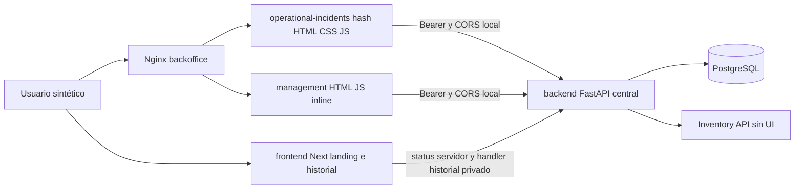
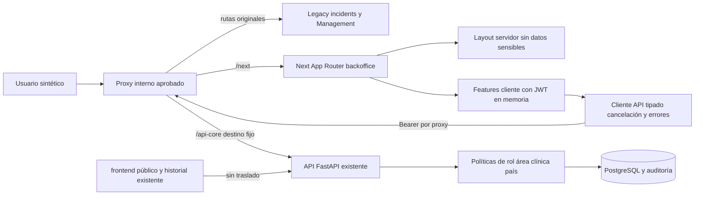
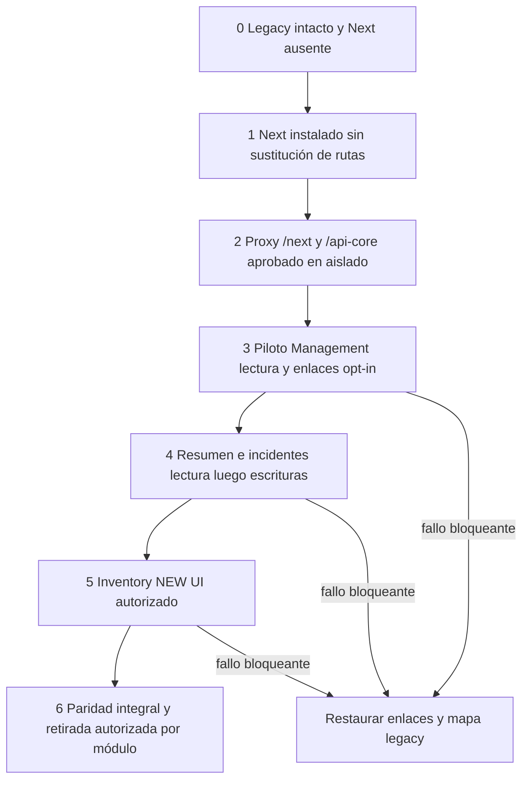

# Plan — HealthCore Backoffice Next.js

**Fecha:** 2026-11-02 · **Estado:** diseño original con implementación sintética posterior; evidencias en [execution.md](./execution.md).
Fuentes y decisiones: [spec.md](./spec.md). Trabajo posterior: [tasks.md](./tasks.md).

## 1. Diagnóstico arquitectónico e inventario técnico

La aplicación operativa nativa usa un módulo `app.js` con estado singleton, render imperativo y router hash; se comparte constructor DOM `select-field.js` y telemetría. Management concentra consultas y HTML en un script inline. Estas implementaciones requieren adaptar DOM/eventos a React; no se pueden importar como componentes.

La plataforma Next existente está en `frontend`, orientada a landing pública, con una excepción interna aprobada para historial. Conservarla separada. La API central real está en `backend`, con uv/Python 3.12, SQLAlchemy async, PostgreSQL, Alembic y módulos de dominio. `services/` mantiene estructura de plantilla, no una segunda API. No existe package.json/pnpm-workspace.yaml raíz ni `.github/` en el árbol inspeccionado: no afirmar runner ni pipeline operativo. `workflows/` es guía organizativa, no evidencia de CI.

| Elemento | Estado observado | Uso propuesto |
|---|---|---|
| Next 16.4.3, React/DOM 19.3.1 | package.json y pnpm-lock frontend coinciden | Base compatible interna; validar instalación y build antes de fijar lockfile nuevo. |
| Node 24, pnpm 10.18.3 | Dockerfile frontend | Reutilizar runtime/toolchain, confirmar engine con paquete resuelto. |
| TypeScript strict | No dependencia/configuración frontend actual | Obligatorio objetivo; versión y @types/react/node requieren aprobación D-02. |
| CSS Modules | page.module.css nativo Next | Preferencia sin librería adicional; tokens compartidos localmente en nuevo backoffice. |
| @repo/shared-types | packages/shared/package.json, types | Reutilizar catálogo de tipos; evaluar conexión file/workspace sin inventar workspace raíz. |
| Telemetría | módulo nativo, config pública Nginx, API | Adaptador React opt-in, contrato vigente; nada de claves server al cliente. |
| Pruebas | pytest backend, node tests cronología/telemetría, scripts audit | Conservar; introducir herramientas frontend sólo D-02. |

## 2. Alternativas evaluadas

| Opción | Ventajas | Límites | Decisión |
|---|---|---|---|
| Añadir todo a frontend/app/internal | Runtime ya disponible, sin nueva app | Mezcla web pública e interna, cookies/prefetch/build y autorización conjunta; ubicación contraria a separación recomendada | No recomendada para backoffice principal; conservar historial existente por D-09. |
| Evolucionar uis/backoffice con Next y legacy hermanos | Un límite interno, sin nueva carpeta raíz, retirada gradual | Runtime nuevo y proxy por aprobar; basePath y assets requieren tests | PROPOSED recomendada D-03. |
| Crear uis/backoffice-next o backoffice-next raíz | Build aislado sencillo | Segundo árbol innecesario y convención no aprobada | Descartada. |
| Reemplazo completo de aplicación | Menor coexistencia final | Alto riesgo, sin paridad gradual ni rollback modular | Descartada. |
| Apps en puertos/dominios separados | Aislamiento y despliegue independiente | CORS actual excluye Next; sesión memoria no compartida, cambio origen | Alternativa de desarrollo sólo tras política CORS aprobada; no fallback automático. |
| Reverse proxy mismo origen por prefijos | Conserva CORS, controla propietario de ruta | No puede leer hash; exige infraestructura revisada | Recomendación convivencia. |
| BFF con cookie/sesión u OIDC | Posible protección servidor futura | Cambio autenticación/CSRF/retención, sin backend aprobado de refresh | OUT OF SCOPE; entrega separada. |

## 3. Arquitectura actual



## 4. Arquitectura recomendada y responsabilidades



App Router sólo compone rutas/layouts/error/loading y metadata interna noindex. Server Components sirven estructura y contenido no sensible; no reciben token de memoria ni tienen acceso directo a DB. Client Components contienen SessionProvider efímero, filtros/forms y datos privados. Layout cliente impide navegación accidental según claims, pero la API autoriza incluso el GET inicial. No prefetch privado antes de conexión.

`lib/api`: funciones por endpoint, DTO generado, ApiError por status, AbortSignal, destino fijo y no reintentos de escritura. `lib/auth`: lifecycle de memoria y presentación de roles; no firma JWT ni política alternativa. `features`: incidentes/Management/Inventory con formularios y adaptadores del dominio. `components`: UI sin lógica de permisos de negocio. `hooks`: lecturas/estado de pantalla, sin store global indiscriminado. `types`: modelos de presentación camelCase, transporte snake_case separado. Telemetría desacoplada del éxito de negocio.

## 5. Directorios previstos (no creados)

```text
uis/backoffice/
  package.json              # Next interno, instalación D-02/D-03
  next.config.ts            # basePath /next, standalone sujeto a aprobación
  tsconfig.json             # strict
  src/
    app/
      layout.tsx
      (connection)/connect/page.tsx
      (workspace)/layout.tsx
      (workspace)/summary/page.tsx
      (workspace)/management/{catalogs,reference-data,audit}/page.tsx
      (workspace)/incidents/page.tsx
      (workspace)/incidents/new/page.tsx
      (workspace)/incidents/[id]/page.tsx
      (workspace)/inventory/...   # sólo si D-04 se aprueba
    components/{ui,layout,forms,tables}/
    features/{management,incidents,inventory}/
    lib/{api,auth,telemetry}/
    hooks/
    types/
    styles/tokens.css
  tests/{unit,components,integration,e2e,fixtures}/
  operational-incidents/    # legacy conservado
  management/               # legacy conservado
  README.md / README.es.md  # documentación futura del componente
```

No settings ni gestión de usuarios sin funcionalidad previa. BasePath implica URL visible `/next/connect` aunque carpeta sea connect. Dockerfile futuro deberá copiar `src`, configuración TypeScript y tipos; no copiar ciegamente Dockerfile público que sólo copia `app`.

## 6. Estrategia y matriz de componentes

Tokens EXISTING: tinta #253b3a, muted #566d69, teal #42766a, oscuro #173f3b, fondo #f5f9fb, blanco; coral #aa5146 en landing. Fuente ui-sans-serif/system-ui/Segoe UI, sin proveedor externo. Espaciados frecuentes 12/16/18/20/24/28/32 px, cards finales radio 18 px, botones/inputs 9 px; overrides al final de styles.css prevalecen sobre radios iniciales. Marca cuadrado 44 px y SVG cruz 26 px. Colores de severidad incluyen texto además de color.

Breakpoints reales: incidentes 900/760/560/420 px; Management 900/760/560 px; landing 1000/800/560. No unificar por preferencia sin comparación. Conservar tabla scrollable (incidentes min-width 760 px), foco de región y legibilidad. Componentes no usan hero/foto de landing en backoffice.

| Componente objetivo | Fuente real | Reutilización / adaptación | Validación |
|---|---|---|---|
| AppShell | .page-shell, topbar, workspace-intro | Adaptar layout HTML a React/CSS Modules | landmarks, skip, móvil |
| Header/Brand | index.html ambos, page.js/page.module.css | Reutilizar SVG/tokens locales; adaptar markup | nombre accesible, foco |
| Sidebar | No existe sidebar verificada | PROPOSED opcional; mantener header nav en piloto | no inventar requerimiento visual |
| Breadcrumbs | .breadcrumbs detalle incidentes | React Link/enlace según owner de ruta | volver preserva filtros |
| PageHeader | .page-heading / h1 / eyebrow | Adaptar sin rediseñar | jerarquía h1 |
| Button | .button final override | Reutilizar CSS, props disabled/busy | foco, submit único |
| Input/Textarea | .field y field-hint | Adaptar label, id, límites | error asociado, trim |
| Select | select-field.js + select nativo | Reusar comportamiento/opciones, no función DOM | teclado/defaults/required |
| DataTable | table-wrap/th/td, table inline Management | React escapado; tabla simple antes de librería | headers, scroll, sin XSS |
| Cards | panel/detail-card/metric-card | Reutilizar tokens/patrones | status/empty/no salto excesivo |
| Modal/Dialog | No modal propio verificado | PROPOSED dialog nativo sólo cuando necesario | Escape, foco/restauración |
| ConfirmationDialog | No patrón reutilizable verificado | Confirmación acotada para acciones críticas aprobadas | sin doble envío |
| Alert | feedback/notice/privacy-notice | Adaptar role=status/alert por urgencia | texto no sólo color |
| Badge | environment-badge/pill | Reutilizar etiqueta sintética y severidad | contraste AA |
| LoadingState | loading-state, aria-busy, lazy fallback | Adaptar por vista | anuncio y recuperación |
| EmptyState | empty-state / Sin resultados | Adaptar contexto y acción de volver | sin asumir error |
| ErrorState | error-state y lazy boundary React | Adaptar códigos/recuperación segura | 401/403/422/503 |
| Footer | ambos HTML, landing institucional | Mantener marca y límites sintéticos internos | sin datos privados |
| Timeline/EventDetails | frontend historial React | Referencia reutilizable posterior D-09; useMemo/dynamic existentes | tests chronology y lazy recovery |

Diseño mínimo local; no crear paquete de design system hasta demostrar consumidores múltiples. Nada de Tailwind/librería de iconos sólo por preferencia.

### Dependencias evaluadas, ninguna añadida

| Dependencia | Necesidad / alternativa | Compatibilidad / impacto / mantenimiento | Recomendación |
|---|---|---|---|
| TypeScript + @types/react/react-dom/node | strict obligatorio; JS no satisface objetivo | Elegir versiones compatibles React 19/Node24/Next instalado; lock nuevo y typecheck | D-02 aprobar e instalar en fase1. |
| Generador OpenAPI (openapi-typescript candidato) | DTO sin duplicar; alternativa types manuales | Validar OpenAPI 3.1/unions/nullability; dev-only, revisión de generación en cambios | D-02, no fijar versión inventada. |
| Vitest + React Testing Library + DOM test runtime | hooks/errores/componentes; alternativa node:test sólo lógica pura | React19/TS/jsdom compatibilidad por verificar; tooling dev y mantenimiento fixtures | D-02 aprobar matriz exacta antes de instalar. |
| Playwright | E2E/roles/keyboard/responsive; alternativa navegador manual y scripts actuales | Navegadores descargables/CI requieren aprobación; coste ejecución | D-02/D-05, necesario para gate progresivo automatizado. |
| axe-core integración de pruebas | Chequeo AA automático parcial; alternativa auditoría/manual existente | Dev-only, no sustituye teclado/lector; versión por resolver | Evaluar con QA, aprobación D-02. |
| TanStack Query | caché/invalidación compleja; alternativa hooks fetch + AbortController | Otra caché a aislar por identidad/scopes; coste medio | Diferir, piloto pequeño no la necesita. |
| React Hook Form/Zod | forms complejos; alternativa estado local/HTML + contrato generado | Validación puede divergir backend; dev/runtime adicional | Diferir hasta necesidad demostrada. |
| Tailwind, Radix u otra UI/table lib | alternativa CSS Modules, controles/dialog/tabla nativos | Reescritura estética/bundle/mantenimiento no justificados | No recomendar inicialmente. |

## 7. Integración API: matriz vigente

Las tablas siguientes se extraen estáticamente de decoradores, firmas y schemas del checkout (sin importar la app ni consultar BBDD). `Depends`/permisos contextuales se complementan con los roles de spec.md y políticas. Los códigos listados son declarados; no garantizan exhaustividad de middleware ni de fallos red. No se ejecutó HTTP en esta entrega. OpenAPI existente en `docs/{serialization,caching}-openapi.json` es snapshot histórico: no asumir cobertura Inventory. En fase0 generar snapshot vigente desde app aislada y contrastar errores runtime y schemas.

Consumidores nativos: F-02 GET /management/catalogs; F-03 GET /management/reference-data/{resource}; F-04 GET /management/audit-events limit=50 y filtro resource_type. F-06 GET /incidents con filtros/orden/offset, limit=20. F-07 POST /incidents; F-08 GET/PATCH item; F-09 POST transitions/assignments; F-10 GET ambos historiales; F-05 GET metrics. F-01 lee cuatro /catalogs y cuatro maestros offset=0 limit=100 excepto direction. No hay consumo UI de management values/mutaciones, incident audit o ComplianceReview: documentados como OUT OF SCOPE adicional, no pantallas migradas.

Todos Inventory corresponden a F-13–F-16 NEW UI propuestos. `/auth/tokens` herramienta de desarrollo externa, no login humano. `/status` consumidor landing/health, no nuevo dashboard. `/telemetry/context` y `/events` opt-in F-12.

### catalogs: `backend/app/catalogs/router.py`

| Método y ruta | Parámetros / entrada | Salida | Autorización declarada / contexto | Éxito y errores declarados | Fuente |
|---|---|---|---|---|---|
| GET `/catalogs/{catalog_name}` | catalog_name: str | `CatalogResponse` | Depends(require_capability('catalog:read')) | 200; 401,403; error_responses(404) | línea 18 |

### incidents: `backend/app/incidents/router.py`

| Método y ruta | Parámetros / entrada | Salida | Autorización declarada / contexto | Éxito y errores declarados | Fuente |
|---|---|---|---|---|---|
| POST `/incidents` | payload: IncidentCreate | `IncidentResponse` | Depends(require_capability('incident:create')) | status.HTTP_201_CREATED; 401,403; error_responses(422, 503) | línea 110 |
| GET `/incidents` | status_value_id: UUID \| None = Query(default=None); severity_value_id: UUID \| None = Query(default=None); responsible_area_id: UUID \| None = Query(default=None); sort_by: str = Query(default='created_at', pattern='^(created_at\|updated_at\|title\|incident_identifier)$'); sort_direction: str = Query(default='desc', pattern='^(asc\|desc)$'); offset: int = Query(default=0, ge=0); limit: int = Query(default=50, ge=1, le=100) | `IncidentListResponse` | Depends(require_capability('incident:list')) | 200; 401,403; error_responses(422) | línea 191 |
| GET `/incidents/metrics/open-by-severity` | — | `list[OpenIncidentsBySeverityResponse]` | Depends(require_capability('incident:list')) | 200; 401,403;  | línea 232 |
| GET `/incidents/{incident_id}` | incident_id: UUID | `IncidentResponse` | Depends(require_capability('incident:read')) | 200; 401,403; error_responses(404, 422) | línea 280 |
| PATCH `/incidents/{incident_id}` | incident_id: UUID; payload: IncidentUpdate | `IncidentResponse` | Depends(require_incident_update_capability) | 200; 401,403; error_responses(404, 422) | línea 295 |
| POST `/incidents/{incident_id}/transitions` | incident_id: UUID; payload: StatusTransitionRequest | `IncidentResponse` | Depends(get_current_actor) | 200; 401,403; error_responses(404, 409, 422, 500) | línea 386 |
| POST `/incidents/{incident_id}/assignments` | incident_id: UUID; payload: IncidentAssignmentRequest | `IncidentResponse` | Depends(require_capability('incident:assign')) | 200; 401,403; error_responses(404, 409, 422) | línea 432 |
| GET `/incidents/{incident_id}/history` | incident_id: UUID | `list[StatusHistoryResponse]` | Depends(require_capability('incident:read')) | 200; 401,403; error_responses(404, 422) | línea 477 |
| GET `/incidents/{incident_id}/assignment-history` | incident_id: UUID | `list[AssignmentHistoryResponse]` | Depends(require_capability('incident:read')) | 200; 401,403; error_responses(404, 422) | línea 495 |
| GET `/incidents/{incident_id}/audit` | incident_id: UUID | `list[AuditEventResponse]` | Depends(require_capability('audit:read')) | 200; 401,403; error_responses(404, 422) | línea 515 |

### management: `backend/app/management/router.py`

| Método y ruta | Parámetros / entrada | Salida | Autorización declarada / contexto | Éxito y errores declarados | Fuente |
|---|---|---|---|---|---|
| GET `/management/catalogs` | offset: int = Query(default=0, ge=0); limit: int = Query(default=50, ge=1, le=100) | `CatalogListResponse` | Depends(require_capability('catalog:read')) | 200; 401,403; error_responses(422) | línea 82 |
| GET `/management/catalogs/{catalog_name}/values` | catalog_name: str; offset: int = Query(default=0, ge=0); limit: int = Query(default=50, ge=1, le=100) | `CatalogValueListResponse` | Depends(require_capability('catalog:read')) | 200; 401,403; error_responses(404, 422) | línea 89 |
| POST `/management/catalogs/{catalog_name}/values` | catalog_name: str; payload: CatalogValueCreate | `ManagedCatalogValueResponse` | Depends(require_capability('catalog:manage')) | status.HTTP_201_CREATED; 401,403; error_responses(404, 409, 422) | línea 108 |
| PATCH `/management/catalogs/{catalog_name}/values/{value_id}` | catalog_name: str; value_id: UUID; payload: CatalogValueUpdate | `ManagedCatalogValueResponse` | Depends(require_capability('catalog:manage')) | 200; 401,403; error_responses(404, 422) | línea 127 |
| POST `/management/catalogs/{catalog_name}/values/{value_id}/activation` | catalog_name: str; value_id: UUID; payload: ActivationRequest | `ManagedCatalogValueResponse` | Depends(require_capability('catalog:manage')) | 200; 401,403; error_responses(404, 422) | línea 153 |
| GET `/management/reference-data/{resource}` | resource: str; offset: int = Query(default=0, ge=0); limit: int = Query(default=50, ge=1, le=100) | `ReferenceValueListResponse` | Depends(require_capability('referenceData:read')) | 200; 401,403; error_responses(404, 422) | línea 171 |
| POST `/management/reference-data/{resource}` | resource: str; payload: ReferenceValueCreate | `ReferenceValueResponse` | Depends(require_capability('referenceData:manage')) | status.HTTP_201_CREATED; 401,403; error_responses(404, 409, 422) | línea 179 |
| PATCH `/management/reference-data/{resource}/{resource_id}` | resource: str; resource_id: UUID; payload: ReferenceValueUpdate | `ReferenceValueResponse` | Depends(require_capability('referenceData:manage')) | 200; 401,403; error_responses(404, 409, 422) | línea 205 |
| POST `/management/reference-data/{resource}/{resource_id}/activation` | resource: str; resource_id: UUID; payload: ActivationRequest | `ReferenceValueResponse` | Depends(require_capability('referenceData:manage')) | 200; 401,403; error_responses(404, 422) | línea 238 |
| PUT `/management/affected-systems/{system_id}/jurisdictions` | system_id: UUID; payload: SystemJurisdictionsUpdate | `list[UUID]` | Depends(require_capability('referenceData:manage')) | 200; 401,403; error_responses(404, 409, 422) | línea 256 |
| GET `/management/audit-events` | resource_type: str \| None = Query(default=None, max_length=100); resource_id: UUID \| None = Query(default=None); offset: int = Query(default=0, ge=0); limit: int = Query(default=50, ge=1, le=100) | `ManagementAuditEventListResponse` | Depends(require_capability('audit:read')) | 200; 401,403; error_responses(422) | línea 282 |

### inventory: `backend/app/inventory/router.py`

| Método y ruta | Parámetros / entrada | Salida | Autorización declarada / contexto | Éxito y errores declarados | Fuente |
|---|---|---|---|---|---|
| POST `/inventory/items` | payload: ItemCreate | `ItemRead` | Bearer inventory_actor + policies/service; scopes clínica/país | 201; 401,403,404,409,422,503;  | línea 22 |
| GET `/inventory/items` | offset: int = Query(0, ge=0); limit: int = Query(50, ge=1, le=100) | `list[ItemRead]` | Bearer inventory_actor + policies/service; scopes clínica/país | 200; 401,403,404,409,422,503;  | línea 28 |
| GET `/inventory/items/{item_id}` | item_id: UUID | `ItemRead` | Bearer inventory_actor + policies/service; scopes clínica/país | 200; 401,403,404,409,422,503;  | línea 34 |
| PATCH `/inventory/items/{item_id}` | item_id: UUID; payload: ItemUpdate | `ItemRead` | Bearer inventory_actor + policies/service; scopes clínica/país | 200; 401,403,404,409,422,503;  | línea 40 |
| POST `/inventory/items/{item_id}/deactivation` | item_id: UUID; payload: ReasonRequest | `ItemRead` | Bearer inventory_actor + policies/service; scopes clínica/país | 200; 401,403,404,409,422,503;  | línea 46 |
| POST `/inventory/items/{item_id}/clinics/{clinic_id}/configuration` | item_id: UUID; clinic_id: UUID; payload: ClinicConfig | `ClinicConfigRead` | Bearer inventory_actor + policies/service; scopes clínica/país | 200; 401,403,404,409,422,503;  | línea 52 |
| POST `/inventory/items/{item_id}/lots` | item_id: UUID; payload: LotCreate | `LotRead` | Bearer inventory_actor + policies/service; scopes clínica/país | 201; 401,403,404,409,422,503;  | línea 58 |
| GET `/inventory/items/{item_id}/lots` | item_id: UUID; offset: int = Query(0, ge=0); limit: int = Query(50, ge=1, le=100) | `list[LotRead]` | Bearer inventory_actor + policies/service; scopes clínica/país | 200; 401,403,404,409,422,503;  | línea 64 |
| POST `/inventory/movements` | payload: MovementCreate | `MovementRead` | Bearer inventory_actor + policies/service; scopes clínica/país | 201; 401,403,404,409,422,503;  | línea 71 |
| POST `/inventory/movements/{movement_id}/correction` | movement_id: UUID; payload: ReasonRequest | `MovementRead` | Bearer inventory_actor + policies/service; scopes clínica/país | 201; 401,403,404,409,422,503;  | línea 77 |
| GET `/inventory/items/{item_id}/stock` | item_id: UUID; clinic_id: UUID; lot_id: UUID \| None = None | `StockRead` | Bearer inventory_actor + policies/service; scopes clínica/país | 200; 401,403,404,409,422,503;  | línea 83 |
| GET `/inventory/items/{item_id}/movements` | item_id: UUID; clinic_id: UUID; offset: int = Query(0, ge=0); limit: int = Query(50, ge=1, le=100) | `list[MovementRead]` | Bearer inventory_actor + policies/service; scopes clínica/país | 200; 401,403,404,409,422,503;  | línea 88 |
| GET `/inventory/stock` | clinic_id: UUID \| None = None; offset: int = Query(0, ge=0); limit: int = Query(50, ge=1, le=100) | `list[StockRead]` | Bearer inventory_actor + policies/service; scopes clínica/país | 200; 401,403,404,409,422,503;  | línea 107 |
| GET `/inventory/reorder` | clinic_id: UUID \| None = None; offset: int = Query(0, ge=0); limit: int = Query(50, ge=1, le=100) | `list[StockRead]` | Bearer inventory_actor + policies/service; scopes clínica/país | 200; 401,403,404,409,422,503;  | línea 118 |
| GET `/inventory/items/{item_id}/audit` | item_id: UUID; clinic_id: UUID; offset: int = Query(0, ge=0); limit: int = Query(50, ge=1, le=100) | `list[AuditRead]` | Bearer inventory_actor + policies/service; scopes clínica/país | 200; 401,403,404,409,422,503;  | línea 132 |
| GET `/inventory/access-denials` | clinic_id: UUID \| None = None; offset: int = Query(0, ge=0); limit: int = Query(50, ge=1, le=100) | `list[AccessDenialRead]` | Bearer inventory_actor + policies/service; scopes clínica/país | 200; 401,403,404,409,422,503;  | línea 144 |

### auth: `backend/app/auth/router.py`

| Método y ruta | Parámetros / entrada | Salida | Autorización declarada / contexto | Éxito y errores declarados | Fuente |
|---|---|---|---|---|---|
| POST `/auth/tokens` | payload: TokenRequest | `TokenResponse` | development/test solamente; 404 en otros entornos | status.HTTP_201_CREATED; 404,422; error_responses(404, 422) | línea 35 |

### compliance: `backend/app/compliance/router.py`

| Método y ruta | Parámetros / entrada | Salida | Autorización declarada / contexto | Éxito y errores declarados | Fuente |
|---|---|---|---|---|---|
| POST `/compliance-reviews` | payload: ComplianceReviewCreate | `ComplianceReviewRead` | Depends(require_capability('complianceReview:manage')) | status.HTTP_201_CREATED; 401,403; error_responses(422) | línea 47 |
| GET `/compliance-reviews/{review_id}` | review_id: UUID | `ComplianceReviewRead` | Depends(require_capability('complianceReview:read')) | 200; 401,403; error_responses(404, 422) | línea 69 |
| PATCH `/compliance-reviews/{review_id}/status` | review_id: UUID; payload: ComplianceReviewStatusUpdate | `ComplianceReviewRead` | Depends(require_capability('complianceReview:manage')) | 200; 401,403; error_responses(404, 409, 422) | línea 78 |

### telemetry: `backend/app/telemetry/router.py`

| Método y ruta | Parámetros / entrada | Salida | Autorización declarada / contexto | Éxito y errores declarados | Fuente |
|---|---|---|---|---|---|
| POST `/telemetry/context` | payload: ContextRequest; previous: str \| None = Header(default=None, alias='X-Telemetry-Context') | `ContextResponse` | Depends(get_current_actor) | 200; 401/403 identidad/contexto, 422 schema; SafeTelemetryRoute sanitiza validación;  | línea 63 |
| POST `/telemetry/events` | payload: TelemetryBatch; credential: str = Header(alias='X-Telemetry-Context') | `TelemetryReceipt` | Depends(get_current_actor) | 200; 401/403 identidad/contexto, 422 schema; SafeTelemetryRoute sanitiza validación;  | línea 76 |

### Endpoints internos Next y salud

| Método/ruta | Consumidor | Entrada | Salida/errores | Autorización y límites |
|---|---|---|---|---|
| POST /api/incident-history | F-11 en frontend | Authorization Bearer; JSON {incident: UUID} | 200 {statusHistory, assignmentHistory}; 401 missing bearer, 422 JSON/UUID inválido, status upstream si falla una lectura, 503 API no disponible | Reenvía GET history/assignment-history, ambas autorizadas; private/no-store, redirect:error, timeout5s; no valida firma localmente. |
| GET /status | landing servidor y health Compose | sin cuerpo | 200 {status:ok,database:connected}; 503 {status:error,database:unavailable} | Sin Bearer, SELECT1; no dashboard empresarial ni datos de dominio. |
| GET /health | operación API | sin cuerpo | 200 {status:ok} | Liveness sin dominio; fuente backend/app/main.py. |

Contratos auxiliares en `backend/app/auth/router.py`:

| Schema | Campos |
|---|---|
| TokenRequest | actor_id: UUID; role: str; area_id: UUID \| None = None; clinic_ids: list[UUID] = []; jurisdiction_ids: list[UUID] = [] |
| TokenResponse | access_token: str; token_type: str = 'bearer' |

Contratos auxiliares en `backend/app/telemetry/schemas.py`:

| Schema | Campos |
|---|---|
| TelemetryBatch | events: list[TelemetryEvent] = Field(min_length=1, max_length=20) |
| TelemetryReceipt | received: int |
| ContextRequest | clinicId: UUID \| None |
| ContextResponse | contextToken: str; sessionId: str; userId: str; jurisdiction: Literal['US', 'UK'] \| None; schemaVersion: Literal[VERSION]; expiresAt: str |

### Autorización Inventory (complemento a las firmas)

Catálogo/lotes: catalog:read para cinco roles; catalog:manage sólo inventoryAdmin. Configuration: manager. In/out: operator/manager. Adjust/correction: manager. Stock/history: operator/manager por clinic_ids, regional/auditor por jurisdiction_ids. Audit/denials: auditor. Describe código EXISTING, sin ampliar permisos.

### Transporte y contratos

Las firmas de la matriz precisan parámetros y tipos; las tablas de schemas siguientes completan campos, herencia y restricciones. Validaciones de negocio adicionales residen en servicios/políticas: referencias activas, ámbitos, transiciones, saldo negativo, compensación única e inmutabilidad. UUID y fechas UTC ISO viajan como texto, no números. Modelos de presentación camelCase requieren adaptadores explícitos; mantener cuerpos de transporte snake_case.

### Schemas catalogs — `backend/app/catalogs/schemas.py`

| Schema / herencia | Campos y restricciones |
|---|---|
| CatalogValueResponse (BaseModel) | id: UUID; key: str; label: str; description: str \| None; is_open: bool \| None; sort_order: int; effective_from: datetime; effective_to: datetime \| None |
| CatalogResponse (BaseModel) | catalog_name: str; version: int; values: list[CatalogValueResponse] |

### Schemas incidents — `backend/app/incidents/schemas.py`

| Schema / herencia | Campos y restricciones |
|---|---|
| IncidentCreate (BaseModel) | title: str = Field(min_length=1, max_length=200); description: str = Field(min_length=1, max_length=10000); clinic_id: UUID; jurisdiction_id: UUID; affected_system_id: UUID; entry_channel_value_id: UUID; incident_type_value_id: UUID; severity_value_id: UUID; responsible_area_id: UUID; compliance_review_id: UUID \| None = None |
| IncidentResponse (BaseModel) | title: str = Field(min_length=1, max_length=200); description: str = Field(min_length=1, max_length=10000); clinic_id: UUID; jurisdiction_id: UUID; affected_system_id: UUID; entry_channel_value_id: UUID; incident_type_value_id: UUID; severity_value_id: UUID; responsible_area_id: UUID; compliance_review_id: UUID \| None = None; id: UUID; incident_identifier: str; reporter_id: UUID; status_value_id: UUID; created_at: datetime; created_by: UUID; updated_at: datetime; updated_by: UUID |
| IncidentListItem (BaseModel) | id: UUID; incident_identifier: str; title: str; clinic_id: UUID; jurisdiction_id: UUID; affected_system_id: UUID; entry_channel_value_id: UUID; incident_type_value_id: UUID; severity_value_id: UUID; status_value_id: UUID; responsible_area_id: UUID; created_at: datetime; updated_at: datetime |
| IncidentListResponse (BaseModel) | items: list[IncidentListItem]; total: int |
| IncidentUpdate (BaseModel) | title: str \| None = Field(default=None, min_length=1, max_length=200); description: str \| None = Field(default=None, min_length=1, max_length=10000); severity_value_id: UUID \| None = None; responsible_area_id: UUID \| None = None; compliance_review_id: UUID \| None = None |
| StatusTransitionRequest (BaseModel) | status_value_id: UUID; reason: str \| None = Field(default=None, max_length=2000) |
| IncidentAssignmentRequest (BaseModel) | responsible_area_id: UUID; reason: str \| None = Field(default=None, max_length=2000) |
| StatusHistoryResponse (BaseModel) | id: UUID; from_status_value_id: UUID \| None; to_status_value_id: UUID; changed_by: UUID; reason: str \| None; changed_at: datetime |
| AssignmentHistoryResponse (BaseModel) | id: UUID; from_responsible_area_id: UUID \| None; to_responsible_area_id: UUID; changed_by: UUID; reason: str \| None; changed_at: datetime |
| OpenIncidentsBySeverityResponse (BaseModel) | severity_value_id: UUID; severity_key: str; severity_label: str; open_incident_count: int |
| AuditEventResponse (BaseModel) | id: UUID; entity_type: str; entity_id: UUID; action: str; actor_id: UUID; before_data: dict \| None; after_data: dict \| None; occurred_at: datetime |

### Schemas management — `backend/app/management/schemas.py`

| Schema / herencia | Campos y restricciones |
|---|---|
| CatalogListItem (BaseModel) | id: UUID; catalog_name: str; version: int; is_active: bool |
| CatalogListResponse (BaseModel) | items: list[CatalogListItem]; total: int |
| ManagedCatalogValueResponse (BaseModel) | id: UUID; key: str; label: str; description: str \| None; is_active: bool; is_open: bool \| None; sort_order: int; effective_from: datetime; effective_to: datetime \| None; created_at: datetime; created_by: UUID; updated_at: datetime; updated_by: UUID |
| CatalogValueListItem (BaseModel) | id: UUID; key: str; label: str; description: str \| None; is_active: bool; is_open: bool \| None; sort_order: int; effective_from: datetime; effective_to: datetime \| None; created_at: datetime; created_by: UUID; updated_at: datetime; updated_by: UUID |
| CatalogValueListResponse (BaseModel) | items: list[CatalogValueListItem]; total: int |
| CatalogValueCreate (BaseModel) | key: str = Field(min_length=1, max_length=100, pattern='^[a-z][A-Za-z0-9]*$'); label: str = Field(min_length=1, max_length=200); description: str \| None = Field(default=None, max_length=2000); is_open: bool \| None = None; sort_order: int = Field(default=0, ge=0); effective_from: datetime; effective_to: datetime \| None = None |
| CatalogValueUpdate (BaseModel) | label: str \| None = Field(default=None, min_length=1, max_length=200); description: str \| None = Field(default=None, max_length=2000); is_open: bool \| None = None; sort_order: int \| None = Field(default=None, ge=0); effective_from: datetime \| None = None; effective_to: datetime \| None = None |
| ActivationRequest (BaseModel) | is_active: bool; reason: str \| None = Field(default=None, max_length=2000) |
| ReferenceValueResponse (BaseModel) | id: UUID; key: str; label: str; is_active: bool; created_at: datetime; created_by: UUID; updated_at: datetime; updated_by: UUID; jurisdiction_id: UUID \| None = None |
| ReferenceValueListItem (BaseModel) | id: UUID; key: str; label: str; is_active: bool; created_at: datetime; created_by: UUID; updated_at: datetime; updated_by: UUID; jurisdiction_id: UUID \| None = None |
| ReferenceValueListResponse (BaseModel) | items: list[ReferenceValueListItem]; total: int |
| ReferenceValueCreate (BaseModel) | key: str = Field(min_length=1, max_length=100, pattern='^[a-z][A-Za-z0-9-]*$'); label: str = Field(min_length=1, max_length=200); jurisdiction_id: UUID \| None = None |
| ReferenceValueUpdate (BaseModel) | label: str \| None = Field(default=None, min_length=1, max_length=200); jurisdiction_id: UUID \| None = None |
| SystemJurisdictionsUpdate (BaseModel) | jurisdiction_ids: set[UUID] |
| ManagementAuditEventResponse (BaseModel) | id: UUID; resource_type: str; resource_id: UUID; action: str; actor_id: UUID; before_data: dict \| None; after_data: dict \| None; reason: str \| None; correlation_id: UUID \| None; occurred_at: datetime |
| ManagementAuditEventListResponse (BaseModel) | items: list[ManagementAuditEventResponse]; total: int |

### Schemas inventory — `backend/app/inventory/schemas.py`

Aliases: Text 1–200; Code 1–100, pattern alphanum + _.−; Unit 1–80; Positive entero estricto 1–10⁹; Count entero estricto 0–10⁹; Reason 1–500. Schema extra=forbid, strip whitespace.

| Schema / herencia | Campos y restricciones |
|---|---|
| Schema (BaseModel) | sólo herencia / validación específica |
| ItemCreate (Schema) | title: Text; product_code: Code; unit: Unit; uses_lots: bool = False; pack_label: Unit \| None = None; pack_size: Positive = 1 |
| ItemUpdate (Schema) | title: Text \| None = None; pack_label: Unit \| None = None; pack_size: Positive \| None = None |
| ItemRead (ItemCreate) | id: UUID; is_active: bool; created_by: UUID; created_at: datetime |
| ReasonRequest (Schema) | reason: Reason |
| ClinicConfig (Schema) | reorder_point: Positive |
| ClinicConfigRead (ClinicConfig) | item_id: UUID; clinic_id: UUID |
| LotCreate (Schema) | code: Code |
| LotRead (LotCreate) | id: UUID; item_id: UUID |
| MovementCreate (Schema) | item_id: UUID; clinic_id: UUID; lot_id: UUID \| None = None; kind: Literal['in', 'out', 'adjust']; quantity: Positive \| None = None; counted_quantity: Count \| None = None; unit: Literal['base', 'pack'] = 'base'; reason: Reason \| None = None |
| EvidenceRead (Schema) | occurred_at: datetime; retention_until: calculado datetime |
| MovementRead (EvidenceRead) | id: UUID; item_id: UUID; clinic_id: UUID; lot_id: UUID \| None; kind: Literal['in', 'out', 'adjust', 'correction']; delta: int; unit: str; pack_label: str \| None; pack_size: int; previous_quantity: int; counted_quantity: int \| None; resulting_quantity: calculado int; correction_of: UUID \| None; reason: str \| None; jurisdiction_id: UUID \| None; jurisdiction_key: str \| None; result: Literal['accepted']; actor_id: UUID; occurred_at: datetime |
| StockRead (Schema) | item_id: UUID; clinic_id: UUID; lot_id: UUID \| None = None; quantity: int; unit: str; pack_label: str \| None; pack_size: int; complete_packs: int; remaining_units: int; reorder_point: int; below_reorder: bool |
| AuditRead (EvidenceRead) | id: UUID; item_id: UUID; clinic_id: UUID \| None; jurisdiction_id: UUID \| None; jurisdiction_key: str \| None; result: Literal['accepted']; actor_id: UUID; action: str; before_data: dict \| None; after_data: dict \| None; reason: str \| None; occurred_at: datetime |
| AccessDenialRead (EvidenceRead) | id: UUID; actor_id: UUID; operation: str; reason_code: Literal['permission', 'scope']; result: Literal['denied']; clinic_id: UUID \| None; item_id: UUID \| None; jurisdiction_id: UUID \| None; jurisdiction_key: str \| None; occurred_at: datetime |

Los validadores completan las tablas: StatusTransition limita motivo a 2000 y lo valida por estado; Assignment exige motivo; audit-output-v1 redacta texto/snapshots. Inventory requiere pack_label si pack_size≠1; ItemUpdate exige un campo y prohíbe null excepto pack_label; adjust exige counted_quantity y reason, sin quantity y en base; in/out exige quantity sin counted_quantity. EvidenceRead calcula retention_until a 24 meses; no purgar desde frontend.

### Filtros, paginación y BACKEND GAP

- Incidentes: filtros status_value_id, severity_value_id, responsible_area_id soportados por servidor; área impuesta para responsibleArea. Orden created_at/updated_at/title/incident_identifier, asc/desc, UUID de desempate. Sin búsqueda libre, clínica o jurisdicción en listado. UI actual 20 filas; API defecto50/máximo100.
- Management: offset/limit y total backend; UI sólo primera página. Un paginador nuevo es ENHANCEMENT por aprobar, no requisito de paridad. Auditoría soporta resource_type/resource_id; UI consume sólo type y limit50. Maestros: jurisdictions, clinics, affected-systems, responsible-areas.
- Inventory: arrays offset/limit defecto50/máximo100 sin total. Stock/reorden soportan clinic_id y scope. Historial por artículo+clínica, país histórico y orden cronológico con UUID. Reorden filtra antes de paginar y revalida con concurrencia: página corta no demuestra fin. Proponer Siguiente explícito y retorno tras página vacía, sin infinite scroll que suponga total.
- Stock permite lot_id; indicador de reorden siempre clínico, sin umbral por lote. Filtrar texto en cliente debe anunciar «página cargada», no búsqueda global.
- Sin GET configuración: stock incluye reorder_point si configurado, si no409. Roles Inventory no pueden leer maestros de Management. Propuesta inicial: UUID explícito de clínica, validado en API, sin convertir claims en nombres autorizados ni pedir endpoints ajenos; UX condicionada a D-04. Un endpoint nuevo de clínicas/configuración requiere entrega separada.
- Sin idempotency key, refresh, me, export ni transiciones permitidas. No llamar endpoints ficticios.

## 8. Autenticación, estado y errores

SessionProvider cliente único para Next, token/claims en memoria; API valida firma/exp/identidad. Expiración local sólo anticipa UX; 401 conserva autoridad. Limpiar campo de contraseña después de conectar, datos/contexto/abort al desconectar o cambiar token; sin persistencia ni sesión compartida con legado. Caracterizar conexión de Management separadamente, porque el token reside en input DOM y no existe botón de desconexión propio.

Estado local: inputs, dirty/submitting y evento seleccionado. URL: filtros/orden/offset no sensibles. Datos remotos: hooks fetch por recurso/identidad/ámbitos con AbortController+epoch, inicialmente no-store. Caché eventual privada descartada al cambiar sesión, nunca singleton servidor. Formularios con estado local para dependencias, validación HTML y límites del contrato; mensajes API asociados a campos, sin duplicar reglas backend en Zod.

| Operación | Tratamiento |
|---|---|
| Lectura | Abort/timeout y reintento manual; datos anteriores sólo de misma identidad, marcados obsoletos. |
| Escritura 2xx confirmada | Bloquear doble clic; usar respuesta y releer detalle/listas/métricas o stock/reorden/historia. |
| 401 | Limpiar privado y reconectar; no refresh/retry automático. |
| 403/404 | Denegado/no encontrado sin éxito supuesto ni evasión de ámbito. |
| 409 | Conflicto de negocio, releer y explicar; preservar inputs. |
| 422 | Validación legible y asociada, sin registrar cuerpo libre. |
| Timeout/red/5xx tras escritura | Resultado incierto; no reenvío automático ni éxito/fallo definitivo inventado. |

Creación sin ID no puede conciliarse inequívocamente mediante API actual: revisar cola/historial y escalar si persiste duda, sin emitir nueva operación automáticamente. Movimientos: verificar historia/stock; compensación única no sustituye conciliación. Sin optimistic updates críticos. PATCH incidentes carece de versión/If-Match: no prometer detección de actualización perdida ni bloqueo ficticio.

## 9. Convivencia por etapas



Runtime Next/Nginx/API desplegables independientemente bajo orquestación aprobada, sin nuevos microservicios de negocio. Mismo origen no comparte memoria; no hay cookies de autenticación. Conservar URL/contexto no secreto y reconectar cuando cambie app. Hash no llega al proxy. No ejecutar dos POST para comparar pantallas: usar datasets independientes sintéticos, nunca repetir operaciones contra datos compartidos.

## 10. Migración por módulos y fases

| Fase | Bloque | Gate |
|---|---|---|
| 0 | Caracterización, snapshot API, roles, visual y baseline | Decidir D-01/02/03/08 y aprobar SDD. |
| 1 | Next strict, shell/conexión, API/errores/tokens UI | Autorizaciones de dependencias, autenticación y conexiones; ninguna ruta sustituida. |
| 2 | F-02 piloto seguido de F-03/F-04 | Management sin writes tiene menor riesgo que Inventory sin UI e incidentes con workflow. |
| 3a | F-05 resumen, F-06 cola, F-08/F-10 lectura | Dirección sin detalle, ámbito propio, historial parcial. |
| 3b | F-07 alta, F-08 editor, F-09 estado/asignación | D-06 conciliación y matriz completa por rol; motivos/grafo reales. |
| 3c | F-11 opcional; F-13 catálogo → F-14 lecturas → F-15 writes → F-16 audit | D-04 NEW UI, Claire para exposición afectada; D-01–D-08 Inventory intactas. |
| 4 | E2E, seguridad, accesibilidad, rendimiento y navegación | Matrices PASS sin evidencias ausentes. |
| 5 | Activación/retirada por módulo | Aprobaciones de deploy y eliminación independientes; rollback probado, sin cambios BBDD. |

## 11. Estrategia de pruebas y paridad

Q identifica suites futuras; no resultados Next entregados aquí. Registrar comando, versión, dataset, resultado y artefacto por tarea.

| ID | Nivel y contenido | Evidencia existente y complemento |
|---|---|---|
| Q-01 | Build/typecheck, drift OpenAPI, DTO/adaptadores | Build frontend histórico, test_management_openapi/test_response_contracts; nueva app aún no construida. |
| Q-02 | Caracterización y componentes Management/estados | HTML y contratos; crear fixtures/expectativas de comportamiento, sin tests espejo JSX. |
| Q-03 | Integración/E2E auth, roles/scopes, XSS, logout/race | test_auth/test_http_authorization/test_inventory_audit_policy; navegador nuevo pendiente. |
| Q-04 | Cola/filtros/orden/paginación, alta/edición/estado/asignación/historial | test_incident_workflows y schemas; equivalencia UI pendiente. |
| Q-05 | Visual, responsive, teclado/lector, errores/foco/contraste | Auditoría histórica; revisión manual/automática en 320/393/760/1350px, zoom200%. |
| Q-06 | Red lenta, abort, respuestas tardías, writes inciertas/concurrentes | Cancelación historial existente; integración nueva controlada en aislado. |
| Q-07 | Rutas/hash/bookmarks/atrás/adelante y sesión entre apps | Rutas actuales verificadas; proxy futuro pendiente de prueba. |
| Q-08 | Inventory e invariantes INV-AC-001–020 | test_inventory/demo/audit_policy; 418 tests históricos documentados, no ejecutados aquí. |
| Q-09 | Producción cold/warm, Profiler, caché y telemetría regional | AUDIT/CACHING_REPORT/telemetry tests; baseline módulos nuevos pendiente. |
| Q-10 | Runtime/build/health/assets, activación/retirada/rollback | Compose existente; nuevas pruebas sólo aisladas y autorizadas. |

Matriz por llenar antes de retirada, con el mismo estado inicial sintético e independiente por UI:

| Escenario | Backoffice actual esperado | Next obtenido | Resultado |
|---|---|---|---|
| Catálogo primera página | columnas catalog_name/version/is_active, total en mensaje | No ejecutado | PENDING |
| Cuatro maestros | key/label/jurisdiction_id/is_active, permiso/error | No ejecutado | PENDING |
| Auditoría type limit50 | admin/compliance, campos redactados | No ejecutado | PENDING |
| Resumen dirección | cuentas por severidad sin descripción | No ejecutado | PENDING |
| Cola orden/filtros/offset20 | total servidor y ámbito propio incluso query manipulada | No ejecutado | PENDING |
| Alta válida/inválida | 201, trim, reporter derivado, 422/403 | No ejecutado | PENDING |
| Editor área propia/ajena | sólo título/descripcion, denegación API | No ejecutado | PENDING |
| Estado/asignación | grafo real, motivo UI, asignación admin, historia | No ejecutado | PENDING |
| Historial parcial/denegado | nativo admite error parcial; handler React exige ambos éxitos | No ejecutado | PENDING |
| Expiración/navegación | error/reconexión; cambios de limpieza aprobados | No ejecutado | PENDING |
| Inventory lectura/escritura/audit | Sin before UI; validar contratos e invariantes | No ejecutado | PENDING NEW UI |

Q-08: artículo base/pack/lotes; stock cero/igual/bajo umbral; entradas/salidas/conteos/compensación y rechazo negativo/concurrente; baja/immutabilidad; país histórico; redacción y denegaciones duraderas. Probar cada rol con clínica/país correcto y ajeno. No purgar datos compartidos ni eludir auditoría para preparar tests.

## 12. Rendimiento

Aplicar spec §8 y D-08: baseline antes de objetivos cuantitativos; loopback no justifica SLO Internet. Sin caché Next privada compartida; diferir sólo cronología/detalle de evento/módulos no iniciales, no autenticación/navegación esencial. Medir tablas 20/50/100 y formularios característicos; useMemo sólo cálculo real con referencias estables.

## 13. Seguridad

Aplicar spec §7: API autoridad, React escapa texto Management, proxy fijo, no-store, sin secretos cliente ni JWT en cookie/storage/URL/log. Entorno sintético explícito. Evaluar TLS/headers/CORS/CSRF/cookies para entorno futuro aprobado, no afirmar configuración actual productiva. No cambiar retención/purga Inventory. Claire revisa exposición/telemetría/tratamiento afectado.

## 14. CI/CD

No se descubrió pipeline operativo. PROPOSED D-05: install frozen → typecheck → contratos → unit/component → build → E2E aislado → accesibilidad → artefacto controlado. Autorización expresa antes de workflows, dependencias y secretos. No inventar GitHub Actions o Kubernetes. Versionar commit/build/tests y gate por módulo, preservando build público independiente.

## 15. Despliegue y activación

Compose/Nginx/Node standalone EXISTING; runtime Next interno/proxy PROPOSED. Gate: build reproducible, health sin PHI, assets/deep links basePath, cabeceras/auth, datos sintéticos, roles y una ejecución por write. Para producción no hay entorno aprobado: autenticación real, hosting/backups y revisión Claire son prerrequisitos externos.

## 16. Rollback

Procedimiento futuro que deberá ensayarse en aislado: detener activación por enlaces/ownership; restaurar mapa Nginx/runtime anterior versionado; smoke ruta/assets/API y rol permitido/denegado; indicar reconexión/contexto perdido sin pasar tokens; conservar logs mínimos y verificar operaciones inciertas por API. Sin borrar volúmenes ni downgrade DB: contratos y almacenamiento permanecen. Inventory no tiene UI legacy: rollback deshabilita entrada nueva y vuelve a herramientas API de desarrollo aprobadas, no a una pantalla antigua inexistente.

## 17. Retirada del legado

Por F: paridad, permisos, AA, rendimiento D-08 y navegación PASS; rollback Q-10 y tráfico autorizado verificados; decisión registrada del responsable. Eliminar archivos o mover F-11 exige autorización independiente. No retirar telemetría/assets compartidos necesarios para módulos restantes.

## 18. Riesgos y mitigaciones

R-01–R-10 en spec. Añadir coste runtime Node, falta pipeline/tests UI, nueva exposición de auditoría y caída por mapa proxy incorrecto. Mitigar con despliegue aislado, tipos generados, mapa versionado y smoke previo; no ampliar contratos.

## 19. Decisiones por aprobar

D-01 JWT memoria/reconexión; D-02 tooling/versiones; D-03 estructura/proxy; D-04 NEW UI/selector clínica Inventory; D-05 CI/runtime/deploy/retirada; D-06 recuperación sin idempotencia; D-07 Claire; D-08 presupuestos después de baseline; D-09 conservación/unificación de historial React. Las decisiones Inventory APPROVED anteriores no autorizan esta nueva UI ni arquitectura.

## 20. Criterios de validación

Diseño: inspección estática, enlaces, IDs/referencias EARS/tasks y cobertura funcional/API; revisión validate-delivery documental, criterios SDD-01–06. No se ejecutan build ni pruebas de migración de una app que no existe. Implementación: tareas/tests por módulo con evidencia y autorizaciones protegidas separadas.


## Registro de ejecución y desviaciones revisables

El desarrollador autorizó expresamente el alcance sintético descrito en spec §15. Los archivos concretos y sus hashes se listan en `changed-files.json`; el código real es la referencia de implementación. Se mantiene el backend Python actual en `/backend`, la web pública en `/frontend` y ambos árboles legacy intactos.

- Nuevo runtime único dentro de `/uis/backoffice`, `basePath=/next`, Next 16.4.3/React 19.3.1/TS 5.9.3/Node 24/pnpm 10.18.3, standalone no root.
- Proxy fijo del servidor contra OpenAPI revisado; sin token issuer, cookies, secretos JWT, SQL, nuevas políticas ni cambios CORS. Sólo `development`/`test`; bodies 64 KiB, abort y timeout, no replay upstream.
- Tipos generados locales por falta de workspace raíz; DTO snake_case separados de etiquetas/vistas. Sin migración artificial a camelCase. Tokens CSS del shell interno, sin modificar estilos anteriores.
- Acciones Inventory en detalle del artículo con clínica/lote UUID explícitos. No se crea endpoint, saldo editable, total ficticio, compras, caducidad, export ni catálogo clínico no autorizado.
- Adaptador de telemetría consume runtime/contrato nativo durante build, deshabilitado por defecto. No se amplía catálogo de eventos a Inventory. Contexto clínico ligado a pathname para impedir reutilizar contexto de otro detalle.
- Override Compose opt-in, no cambios al stack por defecto ni al volumen PostgreSQL. Nginx mantiene raíz/Management; `/next` se proxifica sin ciclo de redirects; cabeceras private/no-store únicas y logs de acceso apagados en la plantilla nueva.

Los resultados y comandos ejecutados se registran en execution.md. El benchmark de Management frío añade aproximadamente 142.8 kB (139.5 KiB) gzip de JS frente al legado; no se afirma mejora global ni presupuesto aceptado. Las pruebas de Nginx utilizaron contenedores temporales y API PostgreSQL sintética; un salto por puerto del host Podman fue intermitente y se sustituyó por conexión directa entre contenedores en el ensayo final.

Rollback ensayado como disponibilidad de rutas: al detener el proxy temporal, los archivos legacy permanecen servibles y los datos siguen en la misma API sintética. No hubo despliegue, activación compartida, eliminación ni downgrade DB. Inventory no tiene fallback anterior. El cierre integral permanece bloqueado por revisiones/gates y evidencia manual/performance pendiente, no por fallos ocultados de pruebas.
